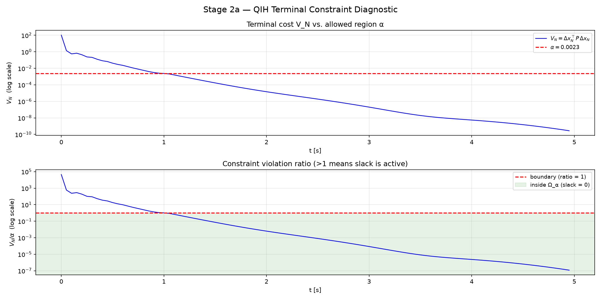

# Stage 2 — Certified Terminal Ingredients (2a QIH, 2b DARE)

| | Stage 2a — Quasi-Infinite Horizon | Stage 2b — DARE terminal cost |
|---|---|---|
| Git tag | `stage2` (13-state model; tag `rigid-body` = all stages before the motor dynamics) | `stage2` |
| Files | `stage2_terminal/compute_qih_params.py` (offline), `ocp_config_qih.py`, `simulate_qih.py` | `stage2_terminal/ocp_config_dare.py`, `simulate_dare.py`, `core/terminal_cost.py` |
| Terminal cost | $W_e = P_{\text{lyap}}$ (modified Lyapunov equation) | $W_e = P_{\text{lqr}}$ (reduced-order DARE) |
| Terminal constraint | $x_N \in \Omega_\alpha$, softened | none |
| Results | `results/stage2a_qih/` | `results/stage2b_dare/` |

Main reference: H. Chen, F. Allgöwer, *A quasi-infinite horizon nonlinear model predictive
control scheme with guaranteed stability*, Automatica, 1998.

## 1. Motivation

Stage 1 ([basic NMPC](stage1_basic_nmpc.md)) uses $W_e = \mathrm{blkdiag}(Q, Q_f)$: a tracking
weight with no connection to the plant. It converges in the nominal run, but nothing in the
formulation proves it, and its 1 s horizon is shorter than the 2 s maneuver. Stage 2 replaces
that arbitrary terminal weight with ingredients derived from the plant, in two ways:

- **2a — Quasi-Infinite Horizon (QIH):** the full Chen–Allgöwer construction, with a terminal
  cost *and* a terminal region in which a local controller is certified to work.
- **2b — DARE terminal cost:** keep only the terminal cost, using the LQR cost-to-go, and drop
  the terminal region.

Plant, prediction model, stage cost, horizon, solver and scenario are identical to Stage 1:
the motor-dynamics model with state $x = [p, v, q, \omega, f] \in \mathbb{R}^{17}$ and the
thrust command $u = f_{\text{cmd}}$ as input ([model](quadrotor_model.md#motor-dynamics)). Both
OCPs import the Stage 1 weights $Q$, $Q_f$, $R_{\text{cmd}}$ and run in the Stage 1 closed loop
(`simulate_basic.simulate(..., create_solver=…)`). Only the terminal treatment changes.

## 2. Formulation

### 2.1 Stage 2a — Quasi-Infinite Horizon NMPC

The zero-terminal constraint of Stage 1 [§2.1](stage1_basic_nmpc.md#21-starting-point-zero-terminal-constraint-mpc) is replaced by three ingredients:

1. a **terminal region** $`\bar{x}(t+T;\,t) \in \Omega_\alpha = \{x : x^\top P x \le \alpha\}`$,
2. a **terminal cost** $F(x) = x^\top P x$,
3. a **local auxiliary controller** $u = Kx$, used only offline to certify (1) and (2) and
   never applied online.

The OCP (in error coordinates, reference at the origin) is

```math
\min_{\bar{u}(\cdot;t)} \int_{t}^{t+T} \Bigl(\|\bar{x}\|_Q^2 + \|\bar{u}\|_R^2\Bigr)\, d\tau \;+\; \|\bar{x}(t+T;\,t)\|_P^2
```

subject to the dynamics, $`\bar{x}(t;\,t) = x(t)`$, $\bar{u} \in \mathcal{U}$, and
$`\bar{x}(t+T;\,t) \in \Omega_\alpha`$. Here $Q = \mathrm{blkdiag}(Q_{\text{body}}, Q_f)$ weights
the state including the thrusts and $R = R_{\text{cmd}}$ the command. acados scales each stage
cost by its time step, so the OCP's stage-cost sum is the Riemann sum of this integral, and
the continuous-time $P$ is used unscaled as the terminal weight.

**What has to be certified.** Inside $\Omega_\alpha$, the local controller must (i) respect the
input bounds and (ii) make the terminal cost decrease at least as fast as the stage cost
accumulates:

```math
\frac{d}{dt}\, x^\top P x \;\le\; -x^\top Q^{*} x, \qquad Q^{*} = Q + K^\top R K, \qquad \forall\, x \in \Omega_\alpha
```

along the *nonlinear* dynamics $\dot x = f(x, Kx)$. Then $F$ upper-bounds the infinite-horizon
cost of the tail, $\Omega_\alpha$ is positively invariant, and the standard argument gives
asymptotic stability and recursive feasibility.

**Design procedure** (Chen & Allgöwer, 1998 → `compute_qih_params.py`):

**Step 0 — Remove $q_w$.** At hover, the linearized $\dot q_w = -(q_x p + q_y q + q_z r)/2$
has zero row in both $A$ and $B$: $q_w$ is a marginal ($\lambda = 0$), uncontrollable mode, so
the pair $(A, B)$ is not stabilizable and Riccati solvers fail. It is also redundant, since
$`\|q\| = 1`$ fixes it. All offline computations use the 16-state model
$[p, v, q_x, q_y, q_z, \omega, f]$. Wherever a reduced state is evaluated on the nonlinear model,
$`q_w = (1 - \|q_v\|^2)^{1/2}`$ puts the quaternion back on the unit sphere; in the OCP, $q_w$
gets a small terminal weight ($T_s$ times its stage weight) that only keeps the Gauss-Newton Hessian regular.

**Step 1 — Stabilizing gain $K$.** The theory needs *some* $K$ with $A_K = A + BK$ Hurwitz; it
does not need $K$ to be the LQR gain of the cost. The implementation takes the LQR gain of a
CARE with a separate input weight $R_{\text{aux}} = s \cdot R$,

```math
A^\top P_{\text{care}} + P_{\text{care}} A - P_{\text{care}} B R_{\text{aux}}^{-1} B^\top P_{\text{care}} + Q = 0, \qquad K = -R_{\text{aux}}^{-1} B^\top P_{\text{care}},
```

and checks $`\max \mathrm{Re}\,\lambda(A_K) < 0`$. Why $s$ matters: the cost's command weight
$R_{\text{cmd}} = 0.01$ is small, so with $s = 1$ the gain is very aggressive and the motors
saturate a few millimetres from hover; the input bounds alone then make $\Omega_\alpha$ tiny. A
gentler $K$ leaves input headroom but less decrease margin. `select_aux_gain()` sweeps
$s \in \{1, 10, \dots, 10^5\}$ and keeps the largest terminal set (volume
$`\propto \alpha^{n/2} (\det P)^{-1/2}`$), see [§5.1](#51-stage-2a--the-terminal-set).

**Step 2 — Modified Lyapunov equation.** Choose $`0 < \kappa < -\max \mathrm{Re}\,\lambda(A_K)`$
(implementation: half the stability margin) and solve

```math
(A_K + \kappa I)^\top P + P (A_K + \kappa I) = -Q^{*}.
```

The equation uses the *cost's* $Q^{*} = Q + K^\top R K$ (with $R$, not $R_{\text{aux}}$), because
$P$ has to bound the cost the OCP actually counts. For the linear system,
$`\mathrm{d}(x^\top P x)/\mathrm{d}t = -x^\top Q^{*}x - 2\kappa\, x^\top P x`$: the $\kappa$ term is a margin.
Along the nonlinear dynamics, with the residual $\varphi(x) = f(x, Kx) - A_K x$,

```math
\frac{d}{dt}\, x^\top P x = -x^\top Q^{*} x \;-\; 2\kappa\, x^\top P x \;+\; 2\, x^\top P\, \varphi(x),
```

so the decrease condition holds wherever the nonlinear term is dominated by the $\kappa$ term.
The price is a larger $P$ than the CARE solution and, through Steps 3–4, a smaller terminal
region.

**Step 3 — Input constraints → $\alpha_1$.** With $u = f_{\text{hover}} + Kx$, the bounds
$f_{\min} \le u_i \le f_{\max}$ become $-(f_{\text{hover}} - f_{\min}) \le K_i x \le f_{\max} - f_{\text{hover}}$.
Over the ellipsoid $x^\top P x \le \alpha$ the worst case has the closed form

```math
\max_{x^\top P x \le \alpha} |K_i x| = \sqrt{\alpha\, K_i P^{-1} K_i^\top},
```

so each motor gives an upper bound on $\alpha$; $\alpha_1$ is the smallest of the four.

**Step 4 — Nonlinearity → final $\alpha$: the decrease condition, checked directly.** Chen &
Allgöwer bound the residual by a Lipschitz constant, $`\|\varphi(x)\| \le L_\varphi \|x\|`$, and
require $`L_\varphi \le \kappa\, \lambda_{\min}(P) / \|P\|_2`$. That is sufficient, but it puts
metres, rad/s and newtons into one Euclidean norm and divides by the condition number of $P$.
On this model it is very conservative: the 13-state version of this stage, which used it, got
$\alpha \approx 10^{-4}$. The implementation checks the inequality the proof actually uses,

```math
m(x) \;=\; \frac{\tfrac{d}{dt}\, x^\top P x \;+\; x^\top Q^{*} x}{x^\top P x} \;\le\; 0 \qquad \forall\, x \in \Omega_\alpha ,
```

with $`\mathrm{d}(x^\top P x)/\mathrm{d}t = 2x^\top P f(x, Kx)`$ evaluated on the nonlinear model. Near the
origin $m \to -2\kappa$; the nonlinearity raises $m$ away from it. The maximum of $m$ over the
ellipsoid is estimated by seeded sampling (4000 points, half on the boundary, half inside)
followed by a local maximization (SLSQP with exact CasADi gradients) from the five worst
samples. $\alpha$ is the largest value, found by bisection on $\log\alpha$ below $\alpha_1$, for
which this maximum is $\le 0$. A local maximum is still a lower bound on the true maximum, so
this remains an empirical certificate, but on the exact condition rather than a bound of a bound.

**Step 5 — Check by simulation.** `check_terminal_set()` runs the auxiliary controller on the
nonlinear model (RK4, 1 ms) for 3 s from 40 random points *on the boundary* of $\Omega_\alpha$ and
checks along every trajectory that the commands stay inside the bounds, that
$x^\top P x \le \alpha$ (invariance), and that $`x^\top P x + \int x^\top Q^* x\, d\tau`$ never
increases (the decrease condition in integrated form).

**Softened terminal constraint.** In the OCP the constraint is implemented as
$`h_e(x_N) = \Delta x_N^\top P_{\text{set}}\, \Delta x_N \le \alpha + s`$, $s \ge 0$, where
$P_{\text{set}}$ is $P$ without the $q_w$ weight, with slack penalty $z_u s + Z_u s^2$
(L1 $z_u = 10^3$, L2 $Z_u = 10^5$). With a large enough L1 weight the softened problem has the
same solution as the hard one whenever the hard one is feasible (exact penalty). When it is
not, the solver still returns a solution instead of failing. The consequence for the
guarantee: **the theory applies only from the moment $s = 0$**. Before that, softening
guarantees a solution, not convergence.

### 2.2 Stage 2b — DARE Terminal Cost

Stage 2b keeps only the terminal cost:

```math
W_e = P_{\text{lqr}}, \qquad A_d^\top P A_d - P - A_d^\top P B_d \bigl(T_s R + B_d^\top P B_d\bigr)^{-1} B_d^\top P A_d + T_s Q_{\text{red}} = 0,
```

where $(A_d, B_d)$ is the ZOH discretization ($T_s = T/N = 0.05$ s) of the 16-state hover
linearization (Step 0 above) and $Q_{\text{red}}$ is $Q$ without the $q_w$ entry
(`core/terminal_cost.compute_thrust_lag_dare_terminal_cost`). $P_{\text{red}}$ is checked for
positive definiteness and embedded into $17 \times 17$, with $T_s$ times the stage weight on
$q_w$ as the small $q_w$ entry. There is no terminal constraint.

**Why the weights are scaled by $T_s$.** acados multiplies every stage cost by its time step,
so the OCP minimizes $`\sum_k T_s\, \ell(x_k, u_k) + x_N^\top W_e x_N`$. The cost-to-go of exactly
this sum is the DARE solution for the weights $(T_s Q, T_s R)$, which is $T_s$ times the
solution for $(Q, R)$. With unscaled weights the terminal cost would be $1/T_s = 20$ times the
tail it stands for. (The 13-state version of this stage, tag `rigid-body`, had that factor.)

**Why it works without a terminal set.** $x^\top P_{\text{lqr}} x$ is the exact infinite-horizon
cost of the linearized system under the LQR gain, so it is a control Lyapunov function near
hover, and it is a much better estimate of the cost-to-go than $Q$. Like in Stage 2a, the
decrease holds with equality for the linearization and has no explicit margin for the
nonlinearity, and there is no constraint forcing $x_N$ into the region where the linearization
is valid. Stability therefore follows from the "sufficiently long horizon" results for MPC with
a CLF terminal cost (Jadbabaie & Hauser 2005): once the horizon is long enough that $x_N$ ends
up near hover, the terminal cost is accurate there. There is no computed bound on how long is
long enough.

## 3. Implementation

Both variants share every setting with Stage 1 except the terminal treatment:

| Item | Stage 2a (QIH) | Stage 2b (DARE) |
|---|---|---|
| Model, stage cost, bounds | Stage 1: 17 states, $`y = [x;\, f;\, f_{\text{cmd}}]`$, $`W = \mathrm{blkdiag}(Q, Q_f, R_{\text{cmd}})`$, $`f_{\min} \le f_{\text{cmd}} \le f_{\max}`$ | same |
| Terminal cost | $W_e = P_{\text{lyap}}$ (continuous-time, 16 states + $q_w$) | $W_e = P_{\text{lqr}}$ (discrete-time, $T_s$-scaled weights, 16 states + $q_w$) |
| Terminal constraint | `con_h_expr_e` $`= \Delta x_N^\top P_{\text{set}}\, \Delta x_N \in [0, \alpha]`$, `idxsh_e = [0]` | none |
| Slack penalties | $z_u = 10^3$, $Z_u = 10^5$ (upper side only) | — |
| Offline result | $R_{\text{aux}} = 10 R$, $\kappa = 0.70$, $\alpha = 2.3 \cdot 10^{-3}$ | $P_{\text{lqr}}$, printed with its ratio to $T_s Q$ |
| Horizon, solver | $N = 20$, $T = 1$ s, `SQP_RTI`, ERK4 with 2 steps per interval, Gauss-Newton, HPIPM | same |

$P_{\text{lyap}}$, $\alpha$ and $x_{\text{ref}}$ are baked into the generated code as numeric
constants, so `ocp_config_qih.py` must be rebuilt (or the reference passed as an acados
parameter) if $x_{\text{ref}}$ changes at runtime.

```bash
./run.sh stage2_terminal/compute_qih_params.py   # gain sweep + terminal-set check (≈ 1 min)
./run.sh stage2_terminal/simulate_qih.py         # → results/stage2a_qih/
./run.sh stage2_terminal/simulate_dare.py        # → results/stage2b_dare/
```

The 13-state version from its tag:

```bash
git checkout stage2
./run.sh simulate_qih.py          # → results/stage2a_qih/
./run.sh simulate_dare.py         # → results/stage2b_dare/
```

## 4. Scenario

Identical to Stage 1: hover-to-hover step from the origin to $`p_{\text{ref}} = (1.0,\; 0.5,\; 1.5)`$ m,
$T_{\text{sim}} = 5$ s, rotor-speed plant without disturbance, full state measured (rotor
speeds included). (The 13-state scripts flew to $(5, 0.5, 6.5)$ m, contrary to their document;
the migration aligned them with Stage 1.)

## 5. Results

### 5.1 Stage 2a — the terminal set

`compute_qih_params.py` sweeps the auxiliary gain:

| $s$ in $R_{\text{aux}} = s R$ | $\alpha$ | limited by | $\kappa$ | $p_x$ half-width | log volume |
|---|---|---|---|---|---|
| 1 (LQR gain of the cost) | $4.9 \cdot 10^{-4}$ | input bounds | 0.82 | 3.3 mm | −57.5 |
| **10** | $\mathbf{2.3 \cdot 10^{-3}}$ | decrease condition | 0.70 | **7.5 mm** | **−45.9** |
| 100 | $1.5 \cdot 10^{-3}$ | decrease condition | 0.45 | 6.5 mm | −51.3 |
| $10^3$ | $5.5 \cdot 10^{-4}$ | decrease condition | 0.25 | 4.0 mm | −62.5 |
| $10^4$ | $1.4 \cdot 10^{-4}$ | decrease condition | 0.14 | 2.1 mm | −77.2 |
| $10^5$ | $2.8 \cdot 10^{-5}$ | decrease condition | 0.08 | 0.9 mm | −94.1 |

The "half-width" is the largest $|p_x|$ in $\Omega_\alpha$ with all other coordinates at hover,
$`(\alpha\, (P^{-1})_{11})^{1/2}`$. With the cost's own LQR gain ($s = 1$) the motors saturate
first. With gentler gains the nonlinearity takes over: a slower $K$ means a smaller $\kappa$,
so less margin to absorb $\varphi$. $s = 10$ balances the two and gives a terminal set about
$e^{11.5} \approx 10^5$ times larger in volume than $s = 1$. Its half-widths, one coordinate at
a time: position 6.5–7.5 mm, velocity 0.03–0.06 m/s, tilt $q_{x,y}$ 0.009 (≈ 1°), body rates
$p, q$ 0.42 rad/s, thrusts ±1.46 N.

The simulation check confirms it on the nonlinear model: from 40 boundary points the
commands stay within $[1.43, 3.32]$ N, $x^\top P x$ never exceeds $0.991\,\alpha$, and
$x^\top P x + \int x^\top Q^* x$ never increases (largest step $-2 \cdot 10^{-10}\, V(0)$).

### 5.2 Stage 2a — when does the trajectory enter $\Omega_\alpha$?



The plot shows the predicted terminal value $`V_N = \Delta x_N^\top P_{\text{set}}\, \Delta x_N`$
against $\alpha = 2.3 \cdot 10^{-3}$ on a log scale.

- **Start:** $V_N \approx 104$, about $4.5 \cdot 10^4$ times $\alpha$. A hard terminal constraint
  would be infeasible here; the slack is active and the solver keeps returning solutions.
- **Transient:** after the first sample $V_N$ drops to $\approx 1$ and then decreases essentially
  monotonically. The small steps come from `SQP_RTI` performing one QP iteration per sample.
- **Entry:** $V_N$ crosses $\alpha$ at $t \approx 1.05$ s, so the constraint is relaxed in 21 % of
  the steps. From then on the slack is zero and the QIH guarantee applies; $V_N$ keeps falling
  to $\approx 10^{-9}$ by the end.

This is the central finding of Stage 2a. Even with the direct decrease condition and the best
auxiliary gain, the certified terminal region is small: positions within millimetres of the
target, tilt within about a degree. The guarantee covers the last 80 % of the run, when the
predicted terminal state is already near hover, and says nothing about the first second,
where the controller does the real work. What limits the region is the quadrotor's
nonlinearity: the attitude kinematics and the thrust direction $R(q)e_z$ couple the states
quadratically, and a stabilizing linear controller can only absorb that within a small
neighborhood of hover.

### 5.3 Why no separate state and input plots

The state and input trajectories of Stage 2a and 2b are visually almost identical to those of
[Stage 1](stage1_basic_nmpc.md#5-results). Position is within 1 cm of the target from
$t = 1.90$ s (Stage 1), $1.95$ s (2a) and $1.95$ s (2b); the pitch peaks are $+25.0°$, $+23.9°$
and $+23.1°$. This is expected: in this nominal scenario the Stage 1 controller already
converges, and the terminal ingredients only change the weighting of the last predicted
state, which has little effect once the trajectory is near hover. What Stage 2 adds is a
*proof* of behavior, not a different trajectory. The figures are in `results/stage2a_qih/` and
`results/stage2b_dare/`; this document shows the diagnostic above instead.

## 6. Takeaways

| | Terminal treatment | Guarantee | Offline effort | Online effort |
|---|---|---|---|---|
| Stage 1 | $W_e = \mathrm{blkdiag}(Q, Q_f)$ | none certified | none | — |
| **Stage 2a — QIH** | $P_{\text{lyap}}$ + $\Omega_\alpha$ (soft) | asymptotic stability + recursive feasibility, for initial states from which $\Omega_\alpha$ is reachable within $T$; with the soft constraint, only once $s = 0$ | CARE + modified Lyapunov + decrease-condition check + gain sweep | one nonlinear terminal constraint + slack |
| **Stage 2b — DARE** | $P_{\text{lqr}}$ | asymptotic stability for a sufficiently long horizon (no explicit bound) | DARE only | none beyond Stage 1 |

- QIH is the textbook-complete answer, but for an agile quadrotor its certified terminal region
  is small, so the hard version is infeasible from realistic initial states and the soft
  version only certifies the final approach.
- How small depends a lot on *how* the region is certified. Checking the decrease condition
  directly instead of through a Lipschitz norm bound, and treating the auxiliary gain as a
  design choice, enlarged it by orders of magnitude; the nonlinearity still sets the limit.
- The DARE terminal cost keeps the useful part of QIH (a plant-derived terminal cost that
  approximates the infinite-horizon tail) without the terminal-set machinery. This is the
  common practical choice in drone NMPC, and it is the terminal cost used from Stage 3 on.
  Its weights must follow the OCP's cost scaling, or it overstates the tail by $1/T_s$.
- Both stages assume a perfect model. With wind or a mass error, the controller settles at the
  wrong equilibrium regardless of terminal ingredients → [Stage 3 — Offset-free NMPC](stage3_offset_free.md).

## References

- H. Chen, F. Allgöwer, "A quasi-infinite horizon nonlinear model predictive control scheme with guaranteed stability," *Automatica*, 1998.
- A. Jadbabaie, J. Hauser, "On the stability of receding horizon control with a general terminal cost," *IEEE TAC*, 2005.
- J. B. Rawlings, D. Q. Mayne, M. M. Diehl, *Model Predictive Control: Theory, Computation, and Design*, 2nd ed., Nob Hill, 2017.
