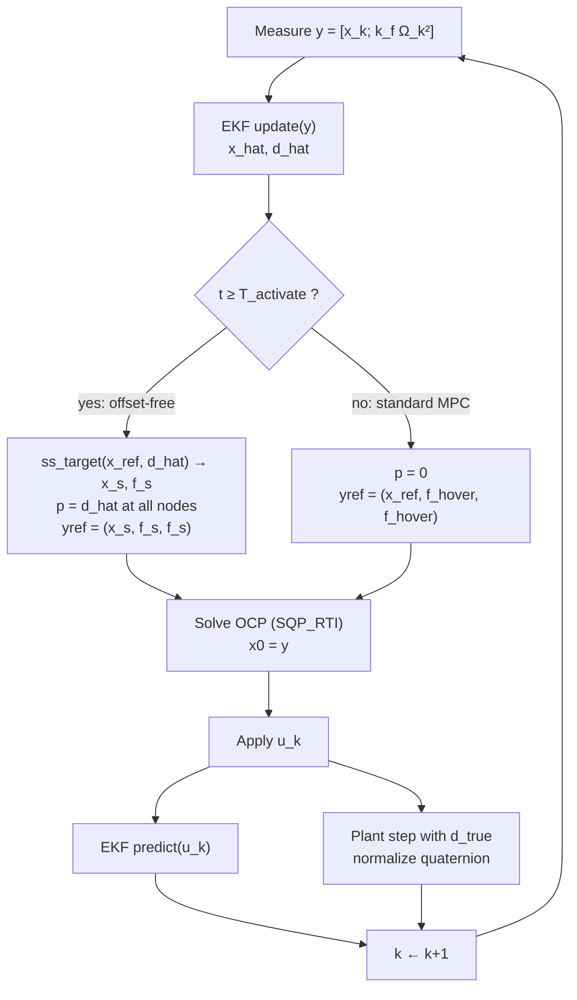
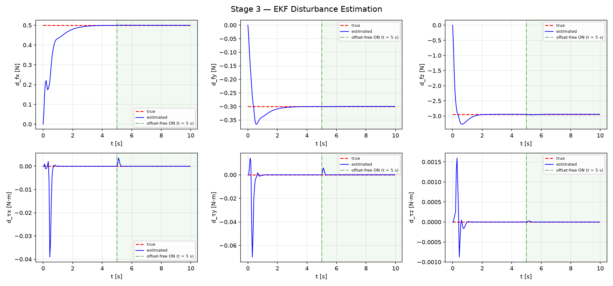
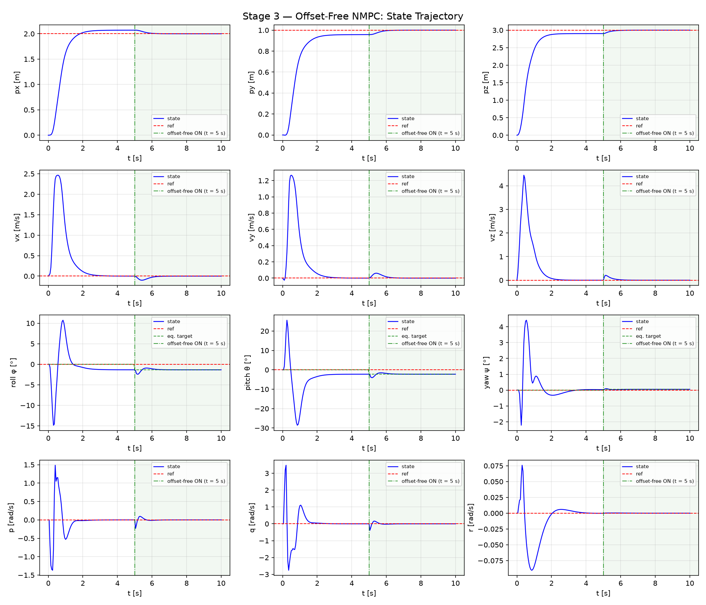
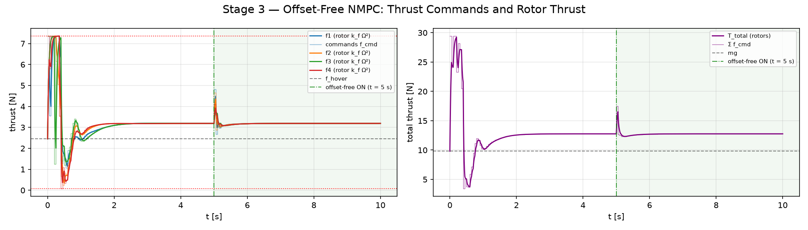
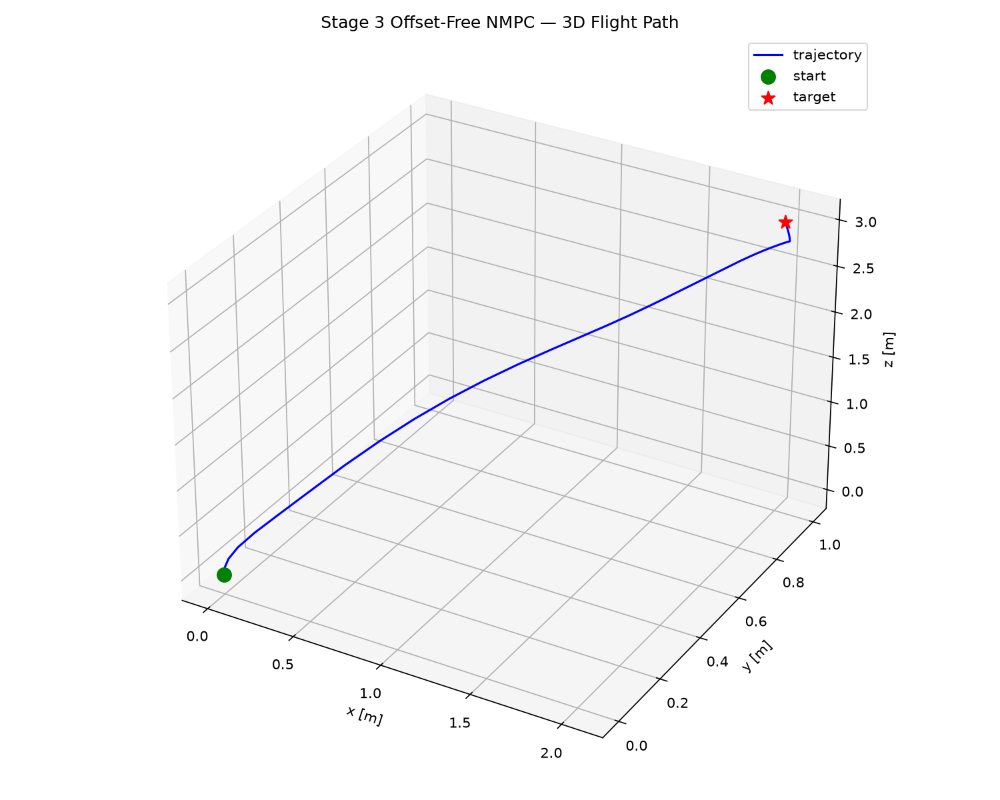

# Stage 3 — Offset-Free NMPC

| | |
|---|---|
| Git tag | `stage3` (13-state model; tag `rigid-body` = all stages before the motor dynamics) |
| Files | `stage3_offsetfree/` `ocp_config_offsetfree.py`, `ekf_aug.py`, `simulate_offsetfree.py` (+ `core/` `ss_target.py`, `quadrotor_model.py`, `plot_utils.py`) |
| Model | motor dynamics: MPC state $[x;\, f]$ (17), input $f_{\text{cmd}}$, rotor-speed plant ([model](quadrotor_model.md)) |
| Method | disturbance-augmented prediction model + augmented EKF + analytical steady-state target calculator |
| Terminal cost | $W_e = P_{\text{dare}}$ ($T_s$-scaled DARE, unchanged from [Stage 2b](stage2_terminal_cost.md)) |
| Results | `results/stage3_offsetfree/` |

## 1. Motivation

Stages 1 and 2 assume the prediction model matches the plant exactly. Under that assumption
the reference is a true equilibrium and the controller converges to it. A real quadrotor
carries **persistent, unmodeled disturbances**: wind, a payload that changes the mass, a
center-of-gravity offset. NMPC has no integral action, so under such a disturbance it
settles at a *neighboring* equilibrium rather than the reference.

Near hover, approximate the NMPC law by a linear feedback $u = u_{\text{ref}} - K(x - x_{\text{ref}})$
acting on $\dot x = Ax + Bu + w$ with a constant disturbance $w$. Since
$(x_{\text{ref}}, u_{\text{ref}})$ is an equilibrium of the nominal model, the steady state satisfies

```math
(A - BK)(x^* - x_{\text{ref}}) = -w \quad\Longrightarrow\quad x^* - x_{\text{ref}} = -(A - BK)^{-1} w,
```

which is nonzero for every $w \neq 0$. Stronger weights shrink the offset but never remove it.

For the quadrotor the offset has a specific structure:

- **Attitude and thrust are fixed by physics.** At any steady state $\dot v = 0$, so thrust and
  tilt must exactly cancel gravity and the force disturbance. The plant settles at that tilt
  regardless of what the controller "intends", because otherwise the velocity would drift.
- **Position absorbs the error.** The translational dynamics are a double integrator and impose
  nothing on *where* the drone hovers. The nominal NMPC still penalizes the required tilt and
  thrust as deviations from level hover, and the only thing that can balance that penalty in
  steady state is a position error. The offset therefore appears in **position**, at the size
  needed to make the feedback law produce the required tilt and thrust.

## 2. Formulation

The fix is the standard offset-free MPC architecture (Muske & Badgwell 2002; Pannocchia &
Rawlings 2003; Morari & Maeder 2012): model the disturbance, estimate it, and steer to the
equilibrium that is reachable under the estimate.

### 2.1 Disturbance-augmented model

A 6-dimensional constant disturbance, split by where it enters:

| Component | Unit | Frame | Physical source |
|---|---|---|---|
| $d_f = [d_{f_x}, d_{f_y}, d_{f_z}]$ | N | world | wind, mass error $`\Delta m\, g`$ |
| $d_\tau = [d_{\tau_x}, d_{\tau_y}, d_{\tau_z}]$ | N·m | body | CoG offset → parasitic torque |

```math
\dot v = \frac{f_{\text{total}}}{m} R(q)_{:,2} - g\, e_z + \frac{d_f}{m}, \qquad
I \dot\omega = \tau(u) - \omega \times (I\omega) + d_\tau, \qquad \dot d = 0,
```

with $\dot p$ and $\dot q$ unchanged, and the thrust lag $\dot f = (f_{\text{cmd}} - f)/\tau_m$ of
the motor model alongside. The disturbance acts on the body, not on the motors. One dynamics
builder (`_build_f_expl`) produces every variant, so all of them share exactly the same physics:

| Variant | Role of $d$ | Dimension | Used by |
|---|---|---|---|
| `create_thrust_lag_model()` | $d = 0$ | $n_x = 17$ | Stages 1–2 |
| `create_thrust_lag_disturbance_model()` | runtime parameter `model.p` | $n_x = 17$, $p \in \mathbb{R}^6$ | MPC, $p = \hat d$ |
| `create_rotor_plant()` | runtime parameter `model.p` | $[x;\, \Omega]$, $p \in \mathbb{R}^6$ | plant, $p = d_{\text{true}}$ |
| `ekf_aug.get_augmented_step()` | extra states | $n_z = 23$ | EKF only |

The MPC never sees $d$ as a state: its dimension stays 17, and $\hat d$ is injected as a
parameter. Only the estimator works with the augmented state.

### 2.2 Augmented EKF

Augmented state $`z = [x;\, f;\, d] \in \mathbb{R}^{23}`$, measurement $`y = Hz = [x;\, f]`$ with
$H = [I_{17} \mid 0]$. The rotor speeds come from the ESC telemetry and are handed over as
$f = k_f \Omega^2$, as in Stage 1. In this stage the full state is measured, so only $d$ is
actually estimated.

**Predict** (with the applied command $u_k$):

```math
\hat z_{k+1|k} = \Phi(\hat z_{k|k}, u_k), \qquad
F_d = \frac{\partial \Phi}{\partial z}\Big|_{\hat z_{k|k},\, u_k}, \qquad
P_{k+1|k} = F_d P_{k|k} F_d^\top + Q_{\text{aug}} T_s,
```

where $\Phi$ is RK4 over $T_s$ in two substeps (as the OCP integrator), $F_d$ its exact Jacobian
from CasADi, and $Q_{\text{aug}} = \mathrm{blkdiag}(Q_x, Q_d)$.

**Why not $F_d \approx I + F_c T_s$.** The 13-state version used this first-order
discretization. The thrust lag adds the eigenvalue $-1/\tau_m = -33\ \text{s}^{-1}$, so the
Euler factor is $1 - T_s/\tau_m = -0.67$: the covariance of $f$ would flip sign every step,
while the true factor is $e^{-T_s/\tau_m} = 0.19$. The Jacobian of the map that actually
predicts the state has the right decay and is consistent with the mean prediction.

**Update** (Joseph form):

```math
S = HPH^\top + R, \qquad K = PH^\top S^{-1}, \qquad \hat z \leftarrow \hat z + K e, \qquad
P \leftarrow (I - KH) P (I - KH)^\top + KRK^\top,
```

with $e = y - H\hat z$. A sign-flip guard handles the quaternion double cover ($q$ and $-q$
are the same rotation).

**How $\hat d$ is learned although $d$ is not measured.** Split the gain into its state and
disturbance rows. The disturbance correction is

```math
\Delta\hat d = K_d\, e = P_{dx}\, S^{-1} e,
```

which is nonzero only because of the cross-covariance $P_{dx}$. The prediction step creates
it: $F_c$ couples $d$ into $\dot x$ (e.g. $\partial \dot v / \partial d_f = I/m$), so uncertainty
in $d$ becomes predicted uncertainty in $x$. A *persistent* prediction error in $x$ is then
attributed to $d$ until $\hat d$ explains it. This is the integral action that standard NMPC
lacks. The augmented pair must be detectable for this to work; with $n_d = 6 \le n_y = 17$
and full-state measurement, it is.

**Tuning** (`get_default_ekf_tuning()`):

| Block | Values | Rationale |
|---|---|---|
| $Q_x$ | $10^{-3}$ (position, quaternion), $10^{-2}$ (velocity, rates, thrusts) | model is accurate; on $f$ it covers the lag mismatch of the rotor plant |
| $Q_d$ | $0.1$ (forces), $0.01$ (torques) | sets adaptation speed; larger → faster but noisier $\hat d$ |
| $R$ | $10^{-3}$ (position, quaternion, thrusts), $10^{-2}$ (velocity, rates) | clean full-state measurement |
| $P_0$ | $`0.01\, I`$ (state), $`1.0\, I`$ (disturbance) | state known, disturbance unknown |

The rotor plant follows a large command step more slowly (spin-up) or faster (spin-down) than
the model's lag ([model](quadrotor_model.md)). The thrust is measured, so $\hat f$ is corrected
directly, but the body dynamics inside one prediction step still run on the model's thrust
curve. During saturated maneuvers this shows up as short transients in $\hat d_\tau$
([§5.1](#51-disturbance-estimation)).

### 2.3 Steady-state target calculator

Injecting $\hat d$ into the prediction model is not enough on its own. The reference
$(x_{\text{ref}}, u_{\text{hover}})$ asks for level attitude *and* the target position, which
cannot both hold under a lateral force. The OCP would still trade position error against
tilt error, and an offset would remain. `ss_target.py` replaces the reference with the
equilibrium that is reachable under $\hat d$.

In general this is an optimization (minimize the distance to the desired output subject to
$f(x_s, u_s, \hat d) = 0$). For the quadrotor it has a closed-form solution, because at
$v = 0$, $\omega = 0$ all rate and gyroscopic terms vanish:

**(1) Force balance → thrust magnitude and direction.**

```math
T_s\, z_b + d_f = m g\, e_3 \quad\Longrightarrow\quad
F_{\text{req}} = [-d_{f_x},\; -d_{f_y},\; mg - d_{f_z}]^\top, \quad
T_s = \|F_{\text{req}}\|, \quad z_b = F_{\text{req}} / T_s.
```

**(2) Attitude from $z_b$ and the reference yaw $\psi$.** $z_b$ fixes roll and pitch; $\psi$
fixes the remaining degree of freedom:

```math
x_c = [\cos\psi,\; \sin\psi,\; 0], \quad
y_b = \frac{z_b \times x_c}{\|z_b \times x_c\|}, \quad
x_b = y_b \times z_b, \quad
R_s = [x_b \mid y_b \mid z_b],
```

converted to $q_s$ with Shepperd's method ($q_w > 0$ enforced). If $z_b$ is nearly
vertical, $y_b = [-\sin\psi, \cos\psi, 0]$ is used.

**(3) Torque balance → motor thrusts.** With $\omega = 0$: $\tau(u_s) = -d_\tau$, so

```math
u_s = M^{-1} \bigl[T_s,\; -d_{\tau_x},\; -d_{\tau_y},\; -d_{\tau_z}\bigr]^\top, \qquad
M = \begin{bmatrix} 1 & 1 & 1 & 1 \\ 0 & -L & 0 & L \\ -L & 0 & L & 0 \\ -c_\tau & c_\tau & -c_\tau & c_\tau \end{bmatrix},
```

clipped to $[f_{\min}, f_{\max}]$ (idle and full thrust) with a warning if a limit is active.

**(4) Assemble.** Position is free at equilibrium, so $`x_s = [p_{\text{ref}};\, 0;\, q_s;\, 0]`$.
On the motor model the thrust is a state, and at rest $f = f_{\text{cmd}}$, so $u_s$ is both the
thrust-state target $f_s$ and the command target.

The OCP now has zero cost at a point the plant can actually hold, so no trade-off remains
and the offset is removed exactly (in the nominal-estimate limit $\hat d = d$).

### 2.4 OCP changes

The OCP structure is the one from Stage 2b. Two runtime updates are added every step:

| | Stage 2b | Stage 3 |
|---|---|---|
| Prediction model | nominal $f(x, u)$ | $f(x, u, p)$ with $p = \hat d$ at all nodes $0 \dots N$ |
| Reference $y_{\text{ref}}$ | fixed $(x_{\text{ref}}, f_{\text{hover}}, f_{\text{hover}})$ | $(x_s, f_s, f_s)$, recomputed from $\hat d$ every step |
| Terminal cost | $P_{\text{dare}}$ | $P_{\text{dare}}$ (unchanged, $d$ does not enter the DARE) |
| State dimension | 17 | 17 |

The terminal cost keeps its role (stabilizing the error dynamics around the equilibrium); the
offset is handled entirely through the prediction model and the moving reference. Because
$P_{\text{dare}}$ is computed at level hover, it is evaluated at a slightly different operating
point when the equilibrium is tilted, which is negligible for tilts of a few degrees.

### 2.5 Closed loop

Per step $k$, in the order of `simulate_offsetfree.py`:

1. **Measure** $`y = [x_k;\, k_f \Omega_k^2]`$ (full state, rotor speeds as thrusts).
2. **EKF update**$(y)$ → $\hat x$, $\hat d$. Runs from $t = 0$, also while offset-free is off.
3. **Switch** at $T_{\text{activate}}$:
   - $t \ge T_{\text{activate}}$: $(x_s, f_s) =$ `compute_ss_target`$(x_{\text{ref}}, \hat d)$, $p = \hat d$, reference $(x_s, f_s, f_s)$ → **offset-free ON**.
   - $t < T_{\text{activate}}$: $p = 0$, reference $(x_{\text{ref}}, f_{\text{hover}}, f_{\text{hover}})$ → **standard MPC** (Stage 2b baseline).
4. **Solve** the OCP (`SQP_RTI`) with $x_0 = y$ (the measured state; $\hat x$ is not needed
   under full measurement).
5. **Apply** the command $u_k$, held for $T_s$.
6. **EKF predict**$(u_k)$.
7. **Plant step** with the true disturbance (rotor-speed `AcadosSimSolver`, 5 substeps of 10 ms),
   then quaternion normalization.



## 3. Implementation

| Item | Setting |
|---|---|
| Stage cost $Q$, $Q_f$, $R$, bounds $[f_{\min}, f_{\max}]$ | identical to Stages 1–2 (imported from Stage 1) |
| Terminal cost | $W_e = P_{\text{dare}}$, 16-state DARE with $T_s$-scaled weights |
| Parameters | `model.p` $= d \in \mathbb{R}^6$, default $0$ |
| Horizon, solver | $N = 20$, $T = 1$ s, $T_s = 0.05$ s, `SQP_RTI`, ERK4 (2 steps), Gauss-Newton, HPIPM |
| EKF | RK4 prediction (2 substeps), exact discrete Jacobian, Joseph update, tuning as in [§2.2](#22-augmented-ekf) |
| Target calculator | closed form, motor clipping to $[f_{\min}, f_{\max}]$ with warning |
| Activation | $T_{\text{activate}} = 5$ s (two equal phases of 5 s) |

```bash
./run.sh stage3_offsetfree/simulate_offsetfree.py   # → results/stage3_offsetfree/
```

The 13-state version from its tag:

```bash
git checkout stage3
./run.sh simulate_offsetfree.py   # → results/stage3_offsetfree/
```

Stage 4 has not been migrated yet. Until it is, it uses `create_rigid_body_solver()` from the
same module: the pre-migration Stage 3 solver, unchanged.

## 4. Scenario

Hover-to-hover step from the origin to $`p_{\text{ref}} = (2,\, 1,\, 3)`$ m, $T_{\text{sim}} = 10$ s.
A constant disturbance acts on the plant from $t = 0$:

| Quantity | Value |
|---|---|
| $d_{f_x}$ | $+0.5$ N (wind) |
| $d_{f_y}$ | $-0.3$ N (wind) |
| $d_{f_z}$ | $-3 \times 0.981 = -2.943$ N ($`\approx 30\%`$ mass error) |
| $d_\tau$ | $0$ |

The run is split into two phases. For $t < 5$ s, standard MPC flies the maneuver and shows the
offset, while the EKF already estimates $\hat d$ in the background. At $t = 5$ s offset-free
control is switched on. (The 13-state version switched at 4 s; the offset was still creeping
by a few tenths of a millimetre then, and two equal halves read more easily.) Because the disturbance is present from the start, the demonstration
isolates the *correction mechanism*; detection delay after a disturbance onset is not tested.

**Expected equilibrium** ([§2.3](#23-steady-state-target-calculator) evaluated for this disturbance, $m = 1$ kg, $\psi = 0$):

| Quantity | Value |
|---|---|
| $F_{\text{req}}$ | $`[-0.5,\; 0.3,\; 12.753]`$ N |
| $T_s$ | $12.77$ N (vs. $mg = 9.81$ N) |
| $u_s$ | $3.19$ N per motor (vs. $f_{\text{hover}} = 2.45$ N) |
| pitch $\theta_s$ / roll $\phi_s$ | $-2.24°$ / $-1.35°$ (total tilt $2.62°$) |

## 5. Results

### 5.1 Disturbance estimation



Starting from $\hat d = 0$, the force estimates stay within $`5\%`$ of their true values from
$1.15$ s ($\hat d_{f_z}$), $1.7$ s ($\hat d_{f_y}$) and $1.85$ s ($\hat d_{f_x}$) on. On the way
$\hat d_{f_z}$ undershoots to $-3.27$ N and $\hat d_{f_y}$ to $-0.37$ N. All of this happens well
before $T_{\text{activate}}$, so the activation transient at $t = 5$ s is caused by the
controller, not by the estimator. Over the last second of the run all six estimation errors
are below $2 \cdot 10^{-6}$ (N and N·m).

The torque estimates show short transients during the first half second, up to $0.07$ N·m in
$\hat d_{\tau_y}$, and small bumps ($< 0.006$ N·m) at activation; no torque disturbance is
injected. They come from the **motor-lag mismatch** ([§2.2](#22-augmented-ekf)): in the first
$0.4$ s the commands jump between idle and full thrust, the rotor plant spins up more slowly
than the model's lag, and the thrust inside a prediction step is wrong by up to $0.5$ N per
rotor. A replay of the same commands through a plant equal to the EKF's model confirms it:

| | $\max\lvert\hat d_\tau\rvert$ [N·m] | $\min \hat d_{f_z}$ [N] |
|---|---|---|
| rotor plant (closed loop) | $0.039,\ 0.070,\ 0.0016$ | $-3.27$ |
| plant = EKF model | $0.0003,\ 0.0008,\ 0.00006$ | $-2.94$ |

The mismatch is real (the hardware has it too) and harmless here: it lasts only while the
commands saturate, and $\hat d$ is clean long before it is used.

### 5.2 States



**Phase 1, standard MPC ($t < 5$ s).** The step is twice the size of Stage 1, so the transient
is more aggressive (pitch $+26° \to -29°$, roll $-15° \to +11°$, $v_z$ up to $4.4$ m/s), and the
commands touch both bounds until $t = 0.4$ s. The loop then settles at a steady state that is
not the reference:

| Position error | $\Delta p_x$ | $\Delta p_y$ | $\Delta p_z$ |
|---|---|---|---|
| standard MPC (mean over $t = 4\text{–}5$ s) | $+70.5$ mm | $-42.5$ mm | $-97.5$ mm |
| offset-free (mean over last 1 s) | $< 0.005$ mm | $< 0.005$ mm | $< 0.005$ mm |

Each offset points in the direction the disturbance pushes: downwind in $x$ and $y$, and
downward under the extra weight. Roll and pitch already sit at $-1.35°$ and $-2.25°$,
which is the equilibrium tilt of [§4](#4-scenario) to within $0.01°$, while the reference still asks for $0°$. This is exactly
the structure predicted in [§1](#1-motivation): physics forces the correct attitude, and the position error is
what the nominal controller needs to keep commanding it.

The offsets are about 20 % larger than on the 13-state model (tag `rigid-body`: $58 / -36 / -79$ mm,
averaged over 3–4 s).
The stage cost now also penalizes the thrust *state* away from hover ($Q_f$), so the
nominal controller resists the required extra thrust more and pays for it with position.

**Phase 2, offset-free ON ($t \ge 5$ s).** The attitude reference (green dashed, `eq. target`)
jumps to $(x_s, f_s)$ and $\hat d$ enters the prediction model. Position is back within 1 cm of
the reference at $t = 6.05$ s and within 1 mm at $6.85$ s, with small velocity bumps
($|v| \le 0.21$ m/s, in $v_z$) and a short attitude dip (pitch to $-4.0°$) that provides the
corrective acceleration. Afterwards position, velocity and rates sit on their references, and
roll/pitch sit exactly on the equilibrium target.

### 5.3 Inputs



Thin steps are the commands $f_{\text{cmd}}$, thick lines the rotor thrust $k_f \Omega^2$, which
lags behind every step by the speed loop. In the first $0.4$ s the take-off saturates the motors
(total rotor thrust up to $29.2$ N, then down to idle on single rotors to stop the climb). In
phase 1 total thrust settles at about $12.8$ N, already close to $T_s$: the plant needs that
thrust to hover regardless of the reference. At activation the command total briefly rises to
$17.5$ N, the rotors deliver $16.5$ N of it before the command drops again, and the drone climbs
the missing $9.8$ cm. Thrust then settles at $12.77$ N with all four motors at $3.19$ N,
matching the analytical $T_s$ and $u_s$ of [§4](#4-scenario). The motors stay equal because no
torque disturbance is present.

### 5.4 Flight path

<p align="center">
  
</p>

The path is again nearly straight. The short hook just below the target is phase 2: the drone
first stops at the offset point and then climbs and shifts onto the reference after
activation.

## 6. Takeaways

- **Under a constant disturbance, nominal NMPC has a steady-state offset, and the offset
  appears in position.** Attitude and thrust are forced to the physically required values;
  position is the free variable that absorbs the mismatch.
- **Estimating the disturbance is necessary but not sufficient.** The disturbance-augmented EKF
  supplies $\hat d$ through the cross-covariance, which acts as integral action. Only the
  target calculator, which replaces the unreachable reference with the reachable equilibrium,
  makes the offset exactly zero.
- **The structure keeps the OCP unchanged.** $d$ enters as a parameter, the state dimension
  stays 17, and the DARE terminal cost is reused.
- **Fast states need a proper discretization in the estimator.** The thrust lag is faster than
  $T_s$; the EKF propagates its covariance with the exact Jacobian of the discrete prediction,
  not with $I + F_c T_s$. The remaining plant–model lag mismatch is visible only as short
  $\hat d_\tau$ transients while the motors saturate.
- **Limitation.** This stage assumes the full state is measured, so the EKF only has to
  estimate $d$. A real drone does not measure velocity directly. Stage 4 removes that
  assumption, measures only $`y = [p;\, q;\, \omega]`$, and compares two estimators for the
  resulting harder problem → [Stage 4a — EKF](stage4a_ekf.md), [Stage 4b — MHE](stage4b_mhe.md).

## References

- K. R. Muske, T. A. Badgwell, "Disturbance modeling for offset-free linear model predictive control," *Journal of Process Control*, 2002.
- G. Pannocchia, J. B. Rawlings, "Disturbance models for offset-free model-predictive control," *AIChE Journal*, 2003.
- M. Morari, U. Maeder, "Nonlinear offset-free model predictive control," *Automatica*, 2012.
- J. B. Rawlings, D. Q. Mayne, M. M. Diehl, *Model Predictive Control: Theory, Computation, and Design*, 2nd ed., Nob Hill, 2017.
