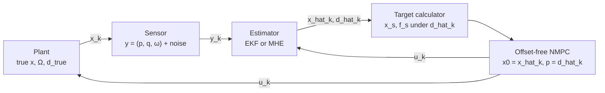
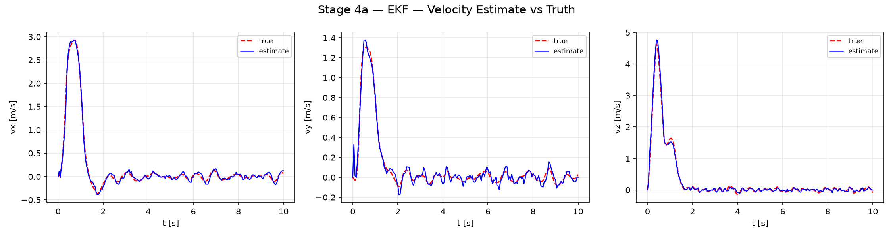
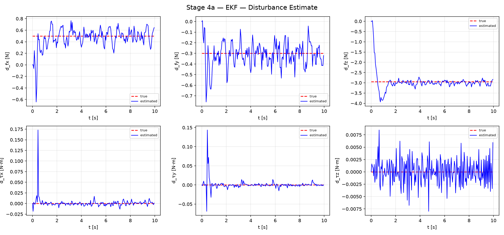
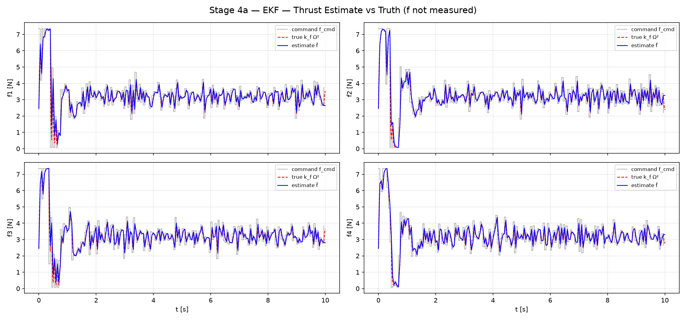
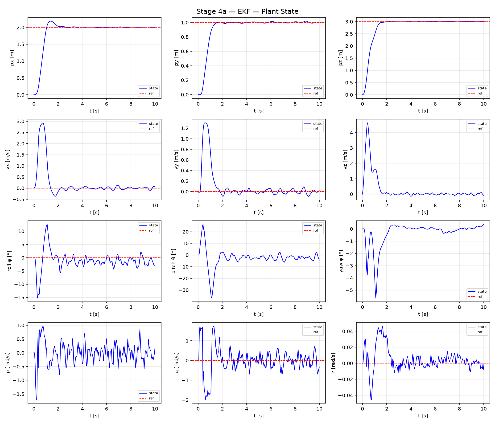
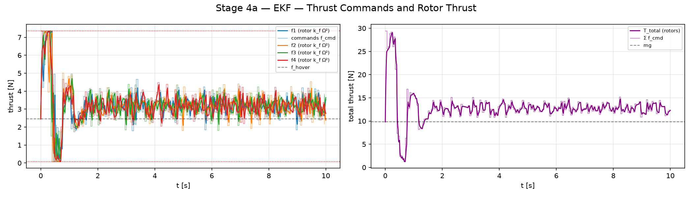
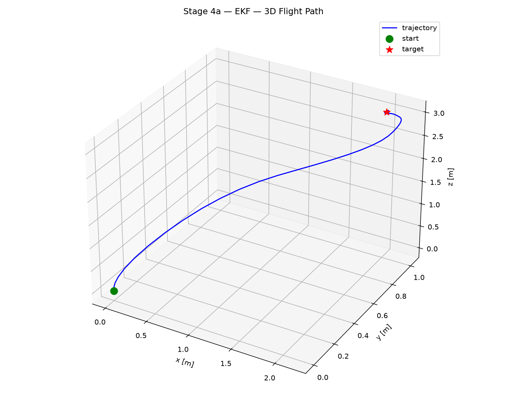
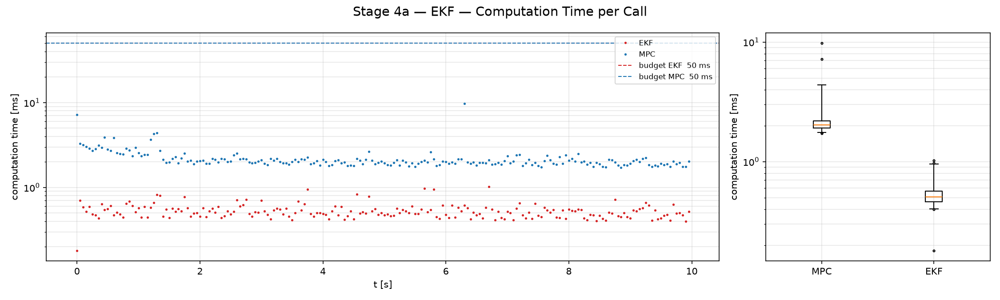

# Stage 4a — Partial Measurement and Augmented EKF

| | |
|---|---|
| Git tag | `stage4` (13-state model; tag `rigid-body` = all stages before the motor dynamics) |
| Files | `stage4_estimation/` `state_est_ekf.py`, `observability_check.py`, `closed_loop.py`, `simulate_ekf.py` (+ `core/sensor_simulator.py`, Stage 3 `ocp_config_offsetfree.py`, `core/ss_target.py`) |
| Model | motor dynamics: MPC state $[x;\, f]$ (17), input $f_{\text{cmd}}$, rotor-speed plant ([model](quadrotor_model.md)) |
| Measurement | $`y = [p;\, q;\, \omega] \in \mathbb{R}^{10}`$ with Gaussian noise; $v$, the rotor thrusts $f$ and $d$ unmeasured |
| Estimator | augmented EKF on $`z = [x;\, f;\, d] \in \mathbb{R}^{23}`$ |
| Results | `results/stage4a_ekf/` |

Stage 4 has two parts that share one closed loop. This document introduces the partial
measurement setting, the shared simulation harness, and the EKF. [Stage 4b](stage4b_mhe.md)
replaces the EKF with a Lyapunov-based MHE and compares the two.

## 1. Motivation

[Stage 3](stage3_offset_free.md) assumed the full state was measured, so the estimator only
had to infer the disturbance $d$. A real quadrotor measures neither its linear velocity nor
the thrust its rotors produce. A motion-capture system, or a fused IMU + GPS/VIO front end,
delivers position, attitude and body rates. Stage 4 adopts that measurement contract:

```math
y = [p;\; q;\; \omega] \in \mathbb{R}^{10}, \qquad v,\ f \text{ and } d \text{ unmeasured}.
```

The estimator must now reconstruct the velocity, the rotor thrusts *and* the disturbance from
the model's coupling, and the MPC is initialized with the estimate $`\hat x = [\hat x;\, \hat f]`$
instead of the true state. Every channel carries sensor noise, so the estimator also has to
filter.

**Scope.** Measurement *noise* is part of this stage. Sensor *fusion* (raw IMU, GPS and VIO
with different rates, biases and latencies) is a separate engineering problem and is left to
a follow-up ROS project. Here $y$ stands for the fused output of an idealized pose source.

## 2. Formulation

### 2.1 Augmented model and measurement

The estimator works on the augmented state of Stage 3,

```math
z = [x;\; f;\; d] \in \mathbb{R}^{23}, \qquad
\dot z = f_{\text{aug}}(z, u) = \begin{bmatrix} f(x, f, d) \\ (f_{\text{cmd}} - f)/\tau_m \\ 0 \end{bmatrix},
```

with a measurement that is a linear selection of $z$:

```math
y = Hz, \qquad
H = \begin{bmatrix} I_3 & 0 & 0 & 0 & 0 & 0 \\ 0 & 0 & I_4 & 0 & 0 & 0 \\ 0 & 0 & 0 & I_3 & 0 & 0 \end{bmatrix} \in \mathbb{R}^{10 \times 23}
```

(blocks $p, v, q, \omega, f, d$). Because $h$ is linear, $H$ is constant and the measurement
update needs no linearization.

**How $f$ is estimated.** The thrusts are predicted from the known commands through the lag
model, and corrected through their effect on the measured motion: the total thrust drives
$\dot v$ (seen in $p$), the differential thrusts drive $\dot\omega$ (seen in $\omega$). These are the
same paths through which $d$ is seen. The two are told apart by their time behavior: $f$ relaxes
to the command with $-1/\tau_m$, $d$ is constant.

### 2.2 Observability at hover

Before any estimator runs, `observability_check.py` verifies that the linearized augmented
pair is observable at hover:

```math
F = \left.\frac{\partial f_{\text{aug}}}{\partial z}\right|_{\text{hover}} \in \mathbb{R}^{23 \times 23}, \qquad
\mathcal{O} = \begin{bmatrix} H \\ H\tilde F \\ \vdots \\ H\tilde F^{22} \end{bmatrix} \in \mathbb{R}^{322 \times 23},
\qquad \tilde F = F\, T_s.
```

**Why $\tilde F = F T_s$.** The thrust lag puts $-1/\tau_m = -33\ \text{s}^{-1}$ into $F$, so the
unscaled $F^{22}$ reaches about $10^{33}$. A rank test with a tolerance relative to the largest
singular value then discards every physical direction: the first version of this check
reported rank 4 out of 23. Observability does not change when $F$ is scaled by a nonzero
constant (the Krylov space is the same), so $\mathcal{O}$ is built from the dynamics over one
sample. As an independent cross-check, the PBH test
$\mathrm{rank}\,[\lambda I - F;\, H] = 23$ is evaluated at both eigenvalues of $F$
($\lambda = 0$ and $\lambda = -1/\tau_m$).

**Result:** $\mathrm{rank}(\mathcal{O}) = 23$ and both PBH ranks are full, so the full augmented
state is locally observable. The unmeasured states reach the measurement through these chains:

| Unmeasured state | Path to a measured signal | Integrations |
|---|---|---|
| velocity $v$ | $v \to \dot p \to p$ | 1 |
| differential thrust | $f \to \tau \to \dot\omega \to \omega$ | 1 |
| torque disturbance $d_\tau$ | $d_\tau \to \dot\omega \to \omega$ | 1 |
| total thrust | $f \to \dot v \to v \to \dot p \to p$ | 2 |
| force disturbance $d_f$ | $d_f \to \dot v \to v \to \dot p \to p$ | 2 |

The force disturbance is the hardest to estimate: it sits two integrations away from the
measured position, so its effect has to be separated from position noise by a model that
double-integrates. The scaled SVD shows this directly: the smallest singular values come as a
pair at $5.0 \times 10^{-2} = T_s$ (one integration) and a triple at $2.5 \times 10^{-3} = T_s^2$
(two integrations), with condition number $\kappa(\mathcal{O}) \approx 3 \times 10^7$.

**What would measuring the thrust add?** For comparison, the check also runs with
$`y = [p;\, q;\, \omega;\, f]`$, as if the ESCs reported rpm telemetry. It is full rank with the
same smallest singular values: locally, the thrust measurement adds no observability. Its
value would be practical: it would correct $\hat f$ directly when the rotors do not follow the
model's lag, which here only happens in the saturated take-off ([§5.3](#53-thrust-estimation)).

This check is local and single-point; [Stage 4b](stage4b_mhe.md#3-detectability-certificate-detectability_checkpy) needs and
provides a much stronger, non-local detectability statement.

### 2.3 Extended Kalman filter

**Prediction** with the applied command $u_{k-1}$, the same as in
[Stage 3](stage3_offset_free.md#22-augmented-ekf):

```math
\hat z_{k|k-1} = \Phi(\hat z_{k-1}, u_{k-1}), \qquad
F_d = \left.\frac{\partial \Phi}{\partial z}\right|_{\hat z_{k-1},\, u_{k-1}}, \qquad
P_{k|k-1} = F_d P_{k-1} F_d^\top + Q,
```

where $\Phi$ is RK4 over $T_s$ in two substeps (as the OCP integrator) and $F_d$ its exact
Jacobian from CasADi (`get_thrust_lag_augmented_step`). The 13-state version used
$F_d = I + F_c T_s$, which was adequate there; with the thrust lag it is not, because the Euler
factor $1 - T_s/\tau_m = -0.67$ would flip the sign of the thrust covariance every step instead
of shrinking it by $e^{-T_s/\tau_m} = 0.19$.

**Update** with $y_k$ (Joseph form, gain via a linear solve instead of an explicit inverse):

```math
S = HPH^\top + R, \qquad K = PH^\top S^{-1}, \qquad
\hat z_k = \hat z_{k|k-1} + K\bigl(y_k - H\hat z_{k|k-1}\bigr), \qquad
P_k = (I - KH)P(I - KH)^\top + KRK^\top.
```

The Joseph form keeps $P$ symmetric positive definite under round-off, which matters here
because $P$ mixes well-conditioned (measured) and weakly observable (force disturbance) modes.

**Quaternion handling.** The additive update ignores $`\|q\| = 1`$, so the quaternion is
renormalized after prediction and after update, with $q_w > 0$ enforced. Before the
innovation is formed, the measured quaternion is flipped if $\langle y_q, \hat q \rangle < 0$:
$q$ and $-q$ are the same rotation, and without the flip a measurement in the other
hemisphere would produce a spurious innovation of magnitude $\approx 2$.

The EKF is a *filter*: $\hat z_k$ already contains $y_k$.

### 2.4 Tuning

$Q$ is specified as a continuous-time spectral density $Q_c$ and scaled per sample,
$Q = Q_c T_s$, so changing $T_s$ does not silently change how fast $\hat d$ may move.
$R$ is matched to the sensor.

| Block | $Q_c$ | per sample ($T_s = 0.05$ s) | $P_0$ | Rationale |
|---|---|---|---|---|
| position | $2 \cdot 10^{-5}$ | $10^{-6}$ | $10^{-2}$ | measured |
| velocity | $2 \cdot 10^{-3}$ | $10^{-4}$ | $1.0$ | unmeasured, absorbs model error |
| quaternion | $2 \cdot 10^{-5}$ | $10^{-6}$ | $10^{-2}$ | measured |
| body rate | $2 \cdot 10^{-5}$ | $10^{-6}$ | $10^{-2}$ | measured |
| thrust | $10^{-2}$ N²/s | $5 \cdot 10^{-4}$ | $0.1$ | unmeasured; prior $f_{\text{hover}}$, $Q$ covers the plant's lag mismatch |
| force disturbance | $0.2$ N²/s | $10^{-2}$ | $1.0$ | sets the $\hat d_f$ bandwidth (≈ 1 s transient) |
| torque disturbance | $2 \cdot 10^{-3}$ N²m²/s | $10^{-4}$ | $0.1$ | well observable through $\omega$ |

$`R = \mathrm{diag}(\sigma_p^2 I_3,\; \sigma_q^2 I_4,\; \sigma_\omega^2 I_3)`$ with the sensor values of [§3.1](#31-sensor-simulator).
The force-disturbance density $Q_{c,f}$ is the main knob: larger values track a disturbance step
faster but pass more measurement noise into $\hat d_f$, and through the MPC into the thrusts.

## 3. Implementation — the shared Stage 4 closed loop

### 3.1 Sensor simulator

`SensorSimulator` maps the plant state to $y$ and adds Gaussian noise
(mocap-equivalent, fixed seed for reproducibility):

| Channel | $\sigma$ | Meaning |
|---|---|---|
| position | $0.01$ m | 1 cm, commercial motion capture |
| quaternion | $0.001$ | $\approx 0.06°$ small-angle equivalent |
| body rate | $0.005$ rad/s | $\approx 0.3°$/s gyro noise |

The noisy quaternion is renormalized. The sensor takes the physical state, not the augmented
$z$: a real sensor never sees the disturbance the estimator invents. It accepts the 13-dim
rigid-body state (the not-yet-migrated MHE run) and the 17-dim motor-model state
$[x;\, f]$ alike and returns $[p;\, q;\, \omega]$ with the same noise sequence; the rotor thrust is
not measured.

### 3.2 Closed loop

`closed_loop.py` is the one loop both Stage 4 estimators run in. The entry scripts
only choose the estimator; sensor, seed, scenario, controller and prior are identical.



where $\hat{x}_k = [\hat x;\, \hat f]$ and $\hat{d}_k$ are the estimator outputs, $x_0=\hat{x}_k$ is the initial state of the OCP, $p=\hat{d}_k$ is the disturbance parameter at all nodes, and $x_s, f_s$ come from the steady-state target for $\hat{d}_k$.


Per step $k$:

1. $y_k = h(x_k) + \nu_k$.
2. $\hat z_k =$ `estimator.step`$(y_k, u_{k-1})$ — the common interface of EKF and MHE.
3. $(x_s, f_s) =$ `compute_ss_target`$(x_{\text{ref}}, \hat d_k)$; the NMPC gets $\hat d_k$ as parameter,
   $(x_s, f_s, f_s)$ as reference and the normalized **estimate** $\hat x_k$ as initial state.
4. The rotor-speed plant advances with the true disturbance (5 substeps of 10 ms, command held).

Step 3 is the key difference from Stage 3: the MPC no longer sees the true state, so
estimation errors now affect the closed loop.

**Shared settings.**

| Item | Setting |
|---|---|
| Rates | plant, sensor, estimator and MPC at $T_s = 0.05$ s (the harness supports an MPC at an integer multiple, $r = 1$ here) |
| Prior | $\bar z_0$ = projection of $y_0$: measured $p, q, \omega$; $\hat v = 0$, $\hat f = f_{\text{hover}}$, $\hat d = 0$ |
| NMPC | Stage 3 offset-free NMPC ($N = 20$, $T = 1$ s, $T_s$-scaled DARE terminal cost, $f_{\text{cmd}} \in [f_{\min}, f_{\max}]$) plus a soft body-rate box $`\lvert\omega_i\rvert \le 0.85\,\omega_{\max} = 1.7`$ rad/s |
| Timing | wall-clock time of every estimator and controller call, `OMP_NUM_THREADS = 1` |

The body-rate box keeps the plant inside the envelope on which the Stage 4b MHE certificate
holds ($\lvert\omega_i\rvert \le 2$ rad/s). It is part of the controller in *both* runs, so it does
not bias the comparison. It does make the transient slower than in Stage 3, where the pitch rate
reached $3.5$ rad/s. The box is soft and the thrust lag delays the braking torque, so the true
rate overshoots it: with the 13-state margin of $0.9\,\omega_{\max}$ the MHE run reached
$2.03$ rad/s, outside the envelope; $0.85\,\omega_{\max}$ keeps both runs inside.

```bash
./run.sh stage4_estimation/observability_check.py   # rank + PBH check at hover
./run.sh stage4_estimation/simulate_ekf.py          # → results/stage4a_ekf/
```

The 13-state version from its tag:

```bash
git checkout stage4
./run.sh observability_check.py    # rank check at hover
./run.sh simulate_ekf.py           # → results/stage4a_ekf/
```

## 4. Scenario

Identical to Stage 3: hover-to-hover step from the origin to $p_{\text{ref}} = (2, 1, 3)$ m,
$T_{\text{sim}} = 10$ s, constant disturbance from $t = 0$ ($d_{f_x} = 0.5$ N, $d_{f_y} = -0.3$ N,
$d_{f_z} = -2.943$ N, $d_\tau = 0$). Offset-free control is active from the start; there is no
activation switch as in Stage 3.

The plant starts hovering at the origin with the rotors at hover speed.

Before the closed loop, the EKF was verified open loop with a noise-free sensor and the hover
command, against the augmented model integrated with 20 RK4 substeps per sample: it holds the
hover fixed point exactly over 10 s, recovers a true $v_x = 1$ m/s that it starts at $0$ (error
$< 10^{-12}$ at 10 s), recovers $d_{f_x} = 0.5$ N (within $5\,\%$ after $0.25$ s,
error $< 10^{-12}$ at 10 s), and recovers rotor thrusts that differ from its hover prior by
$\pm 0.3$ N (error $< 10^{-7}$ after $0.5$ s, while $\hat d$ moves by at most $0.002$ N).

## 5. Results

Steady-state numbers below cover $t = 5\text{–}10$ s, after all transients. Errors are the norm of the
per-axis mean absolute error, as computed by `closed_loop.metrics()`.

### 5.1 Velocity estimation



Velocity is the state that must be inferred, so this is the real test of the estimator. During
the maneuver the EKF tracks the true velocity closely, including the $4.6$ m/s peak in $v_z$
at $t = 0.4$ s (largest error during the first 2 s: $0.21$, $0.35$, $0.26$ m/s in $x, y, z$).
In steady state the estimate carries visible noise: the velocity error is
$50$ mm/s (13-state version: $53$ mm/s). Position noise of 1 cm per sample, differentiated by
the filter over one $50$ ms step, is the main source.

### 5.2 Disturbance estimation



The force estimates reach the right *mean* within about $1$ s, as intended by the tuning. In
the first second, while the take-off saturates the motors, $\hat d_{f_z}$ dips to $-4.0$ N and
$\hat d_{f_x}$, $\hat d_{f_y}$ swing by up to $0.8$ N: the thrust estimate is wrong there
([§5.3](#53-thrust-estimation)), and the EKF explains part of the resulting motion with $d$. Over
$t = 5\text{–}10$ s the estimates fluctuate with a standard deviation of about $0.1$ N on all three
axes ($0.11$, $0.09$, $0.09$ N for $x, y, z$). Relative to the true values this matters most for
the horizontal components: $\pm 0.1$ N is small against $2.94$ N in $z$ but $`20\text{–}30\%`$ of
$0.5$ N and $0.3$ N in $x$ and $y$. The torque estimates fluctuate around zero with a standard
deviation of $2\text{–}5 \cdot 10^{-3}$ N·m.

**A small bias in $\hat d_{f_z}$, and why it does no harm.** The horizontal estimates are nearly
unbiased (mean error $\le 0.009$ N), but $\hat d_{f_z}$ sits $0.058$ N below the true value. The
cause is the motor model: under the noisy commands the rotors spin down faster than they spin
up, so on average they deliver less than commanded. Over $t = 5\text{–}10$ s the commands sum to
$12.83$ N, the rotors to $12.77$ N. The EKF's lag is symmetric, so its total thrust estimate sits
in between ($12.81$ N, $0.04$ N too high), and it balances the excess with an extra downward
$\hat d_{f_z}$. The position nevertheless has no bias (mean offset $\le 1.3$ mm per axis):
$\hat d$ is a *lumped* disturbance that absorbs every steady mismatch between model and plant,
not just the wind and the mass, and offset-free control only needs the model with $\hat d$ to
predict the plant correctly.

### 5.3 Thrust estimation



Gray steps are the commands, red the true rotor thrust $k_f \Omega^2$, blue the estimate. In
steady state $\hat f$ follows the rotors with a mean absolute error of $0.014\text{–}0.020$ N per
motor, well inside the command fluctuations of $\pm 0.5$ N. The exception is the saturated
take-off: between $0.4$ and $0.8$ s the commands drop to idle, the rotors spin down faster than
the model's lag predicts, and $\hat f$ stays too high by up to $0.9$ N on single motors. Nothing
measures the thrust directly, so the error is only corrected through the motion it causes.

### 5.4 States and inputs



Position overshoots by $19$ cm in $x$ at $t = 1.40$ s (13-state version: $15$ cm), is within 5 cm
of the reference at $1.95$ s and within 3 cm at $2.05$ s. The overshoot comes from the take-off
transient: with $\hat f$ too high while the rotors idle, the MPC brakes from a wrong state and
pitches to $-37°$ to recover. Afterwards the drone holds the reference with an error of $10$ mm
and no bias (mean offset $\le 1.3$ mm per axis). The pitch rate runs into the $1.7$ rad/s box
twice and overshoots it to $1.98$ rad/s ([§3.2](#32-closed-loop)), just inside the $2$ rad/s envelope
of the Stage 4b certificate.
Roll and pitch settle around the equilibrium tilt of Stage 3
($\phi_s = -1.35°$, $\theta_s = -2.24°$; measured mean $-1.43°$, $-2.17°$), but with a standard
deviation of $1.4°$ and $1.8°$: the noisy $\hat d$ moves the target attitude, and the noisy $\hat v$
moves the MPC's initial state.



The same noise is visible in the thrusts. Thin steps are the commands, thick lines the rotor
thrust $k_f\Omega^2$. The commands fluctuate with a standard deviation of $0.47\text{–}0.56$ N per
motor ($0.96$ N in total); the rotors smooth them through the speed loop to $0.30\text{–}0.33$ N
($0.68$ N in total). The mean rotor thrust is $12.77$ N, the equilibrium $T_s$.

<p align="center">
  
</p>

The vertical motion comes in two bursts ($v_z$ peaks of $4.6$ m/s at $t = 0.4$ s and $1.6$ m/s at
$1.05$ s), separated by the idle-thrust braking phase, while $x$ overshoots and returns. The path
therefore bends past the target in $x$ before settling.

### 5.5 Computation time



The EKF takes $0.5$ ms per step on average ($0.8$ ms at the 99th percentile), the MPC
$2.2$ ms. Both are far below the $50$ ms sample time. The EKF is faster than the 13-state
version although its state is larger: the prediction is now one compiled CasADi call for the
step and its Jacobian, instead of four Python-level RK4 stage evaluations plus a Jacobian.
Wall-clock numbers vary from run to run.

## 6. Takeaways

- **The partial-measurement loop works.** With only $`[p;\, q;\, \omega]`$ measured, the augmented
  EKF reconstructs velocity, rotor thrusts and disturbance well enough for offset-free
  tracking: no position bias, attitude and thrust at the analytical equilibrium on average.
- **Unmeasured thrust costs transient quality, not steady-state accuracy.** $\hat f$ is accurate
  to $0.02$ N in steady state but off by up to $0.9$ N while the motors saturate, which turns
  into a larger overshoot.
- **$\hat d$ is a lumped disturbance.** It also absorbs the plant's lag asymmetry
  ($0.06$ N in $\hat d_{f_z}$), and the position stays unbiased anyway.
- **Check the numerics of a check.** Fast states (the thrust lag) break both the Euler
  covariance step and the unscaled observability matrix; the exact discrete Jacobian and a
  time-scaled $\mathcal{O}$ with a PBH cross-check fix them.
- **The price is noise.** The EKF reacts within one sample and converges in about 1 s, but the
  same bandwidth passes sensor noise into $\hat v$ and $\hat d$, and from there into attitude and
  motor commands. This is the usual Kalman trade-off, set here by $Q_{c,f}$.
- **The tuning is a choice, not a certificate.** $Q$ was chosen by hand for a fast transient.
  Nothing in the EKF proves convergence; observability holds only locally at hover.

Stage 4b replaces the hand-tuned filter by an MHE whose weights come from a detectability
certificate, and compares both in this same loop → [Stage 4b — MHE](stage4b_mhe.md).

## References

- D. Simon, *Optimal State Estimation: Kalman, H∞, and Nonlinear Approaches*, Wiley, 2006.
- G. Pannocchia, J. B. Rawlings, "Disturbance models for offset-free model-predictive control," *AIChE Journal*, 2003.
