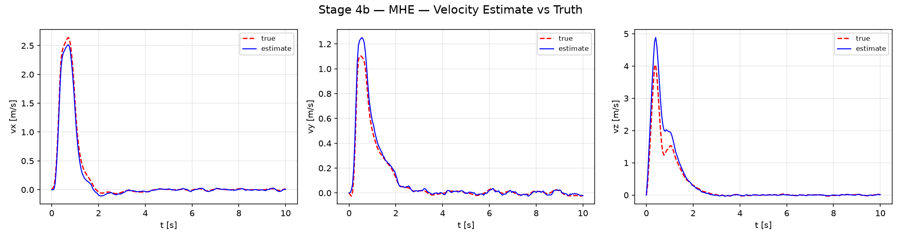
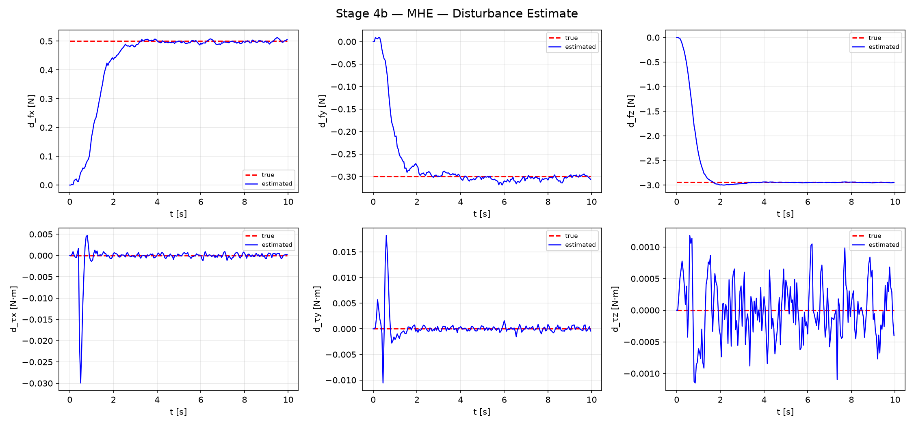
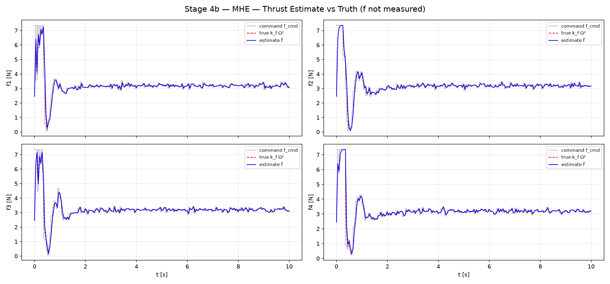
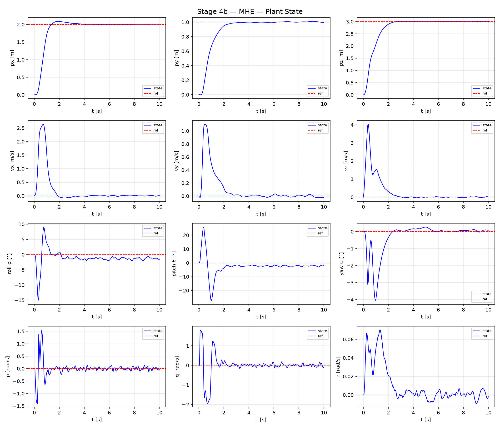
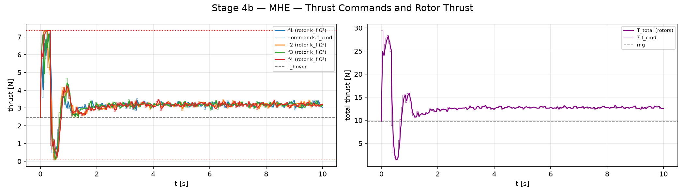
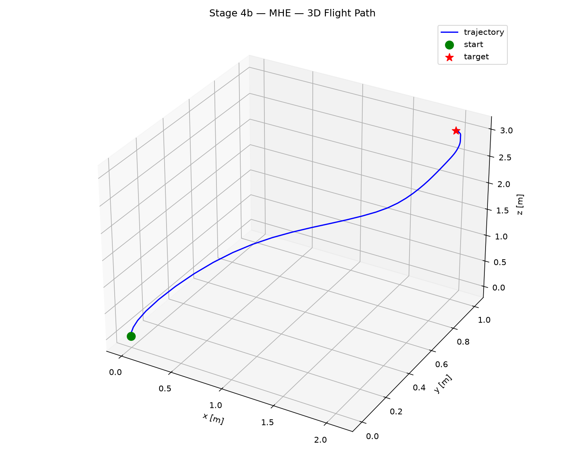
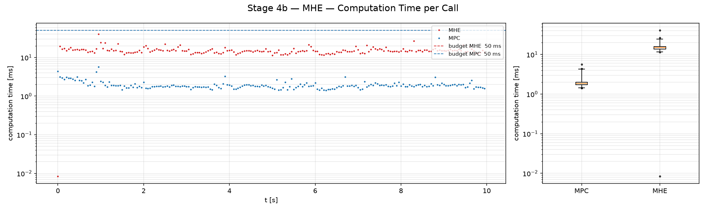
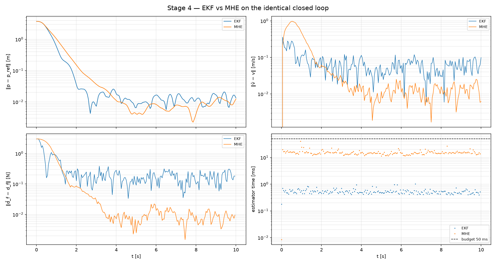

# Stage 4b — Lyapunov MHE and Comparison with the EKF

| | |
|---|---|
| Git tag | `stage4` (13-state model; tag `rigid-body` = all stages before the motor dynamics) |
| Files | `stage4_estimation/` `detectability_check.py` (offline), `ocp_config_mhe.py`, `state_est_mhe.py`, `simulate_mhe.py`, `simulate_compare.py` (+ shared loop `closed_loop.py`) |
| Model | motor dynamics: estimator state $[x;\, f;\, d]$, thrust commands as known input, rotor-speed plant ([model](quadrotor_model.md)) |
| Estimator | moving horizon estimator on $`z = [x;\, f;\, d] \in \mathbb{R}^{23}`$, weights from an i-iIOSS (LMI) certificate |
| Certificate | `data/mhe_params.npz` — $P$, $Q$, $R$, $\lambda$, $T_{\min}$, envelope |
| Results | `results/stage4b_mhe/`, `results/stage4_compare/` |

Main references:
J. D. Schiller, S. Muntwiler, J. Köhler, M. N. Zeilinger, M. A. Müller, *A Lyapunov function
for robust stability of moving horizon estimation*, IEEE TAC 68(12), 2023
([arXiv:2202.12744](https://arxiv.org/abs/2202.12744)) — discrete time;
J. D. Schiller, M. A. Müller, *Robust stability of moving horizon estimation for
continuous-time systems*, 2024 ([arXiv:2305.06614](https://arxiv.org/abs/2305.06614)) —
continuous time, the version implemented here. Equation numbers refer to the 2024 preprint.

## 1. Motivation

The [Stage 4a](stage4a_ekf.md) EKF works, but it has three weaknesses:

- **Hand tuning.** Its covariances were chosen for a fast transient, and they directly set how
  much sensor noise reaches $\hat v$, $\hat d$ and the motors.
- **Local.** It linearizes once per step; observability was verified only at hover.
- **No guarantee.** Nothing proves that the estimation error converges.

A moving horizon estimator (MHE) solves an optimization over a window of past measurements
instead of a one-step recursion. It can use the nonlinear model over the whole window, respect
constraints, and average noise over many samples. The Lyapunov MHE of Schiller et al. adds
the missing theory: if the system satisfies a detectability condition in Lyapunov form, and
the MHE uses the weights of that Lyapunov function and a long enough horizon, the estimation
error is robustly exponentially stable. Stage 4b implements this on the same augmented state
and in the same closed loop as the EKF, so the estimator is the only difference.

## 2. Theory

### 2.1 Detectability as an incremental Lyapunov function

Consider $\dot z = f(z, u, w)$, $y = h(z)$, with a generalized disturbance $w$. The system is
**i-iIOSS** (integral incremental input/output-to-state stable, the continuous-time detectability
notion of the 2024 paper) with a quadratic Lyapunov function if there are $P \succ 0$,
$Q, R \succeq 0$ and $\kappa > 0$ such that for any two trajectories with the same input

```math
\frac{d}{dt}\|z - \tilde z\|_P^2 \;\le\; -\kappa\, \|z - \tilde z\|_P^2 + \|w - \tilde w\|_Q^2 + \|y - \tilde y\|_R^2 .
```

Reading: two trajectories converge at rate $\kappa$ *unless* their disturbances or their outputs
differ. If they produce the same outputs under the same disturbances, they must converge,
which is exactly detectability. $Q$ and $R$ are supply rates: how much a disturbance or output
difference can "pay for" growth of the Lyapunov function. The decay per second is
$\lambda = e^{-\kappa}$.

### 2.2 MHE cost and stability result

At time $t$ the MHE optimizes the state at the start of the window $[t - T, t]$ and the
disturbance trajectory, with cost (paper, eq. 9)

```math
J = 2\,\lambda^{T}\, \bigl\|\hat z(t - T) - \bar z\bigr\|_P^2
\;+\; \int_{t-T}^{t} \lambda^{\,t - \tau} \Bigl(2\,\|\hat w(\tau)\|_Q^2 + \|\hat y(\tau) - y(\tau)\|_R^2\Bigr)\, d\tau ,
```

subject to the model. The estimate is the end point $\hat z(t)$. Three features distinguish it
from a hand-tuned MHE:

1. **The weights are the certificate.** $P$, $Q$, $R$ and $\lambda$ are those of [§2.1](#21-detectability-as-an-incremental-lyapunov-function), not tuning parameters.
2. **Filtering prior.** $\bar z$ is the estimate the MHE *delivered* for time $t - T$, not a
   smoothed value from the previous window.
3. **Discounting.** Older data is weighted down by $\lambda^{t-\tau}$; the prior by $\lambda^T$.

The factors 2 come from Young's inequality in the proof, which compares the MHE solution with
the true trajectory (a feasible candidate). With $P_1 = P_2 = P$ the result is:

```math
\boxed{\;T > T_{\min} = \frac{\ln 4}{\kappa}\;} \quad \text{(paper, eq. 17)}
\quad\Longrightarrow\quad \text{robust global exponential stability of the estimation error},
```

with guaranteed contraction rate $\rho = 4^{1/T}\lambda$ per second (eq. 18). The bound is in
**seconds**, independent of the sample time: a shorter sample time needs more nodes for the
same window. The guarantee is robust, not exact: the error is bounded by a discounted
term in the true disturbances.

### 2.3 Verifying detectability with an LMI

For $\dot z = f(z, u) + w$ (so $B = \partial f / \partial w = I$) and a linear measurement
$y = Cz$ ($D = 0$), the i-iIOSS inequality holds on a **convex** set if the LMI (paper, eq. 31)

```math
\begin{bmatrix} PA + A^\top P + \kappa P - C^\top R C & PB \\ B^\top P & -Q \end{bmatrix} \preceq 0,
\qquad A = \frac{\partial f}{\partial z},
```

holds at every point of that set. The proof integrates along the straight line between two
states, so the line must stay inside the set where the LMI was imposed; this is why convexity
is required.

## 3. Detectability certificate (`detectability_check.py`)

### 3.1 Model and sets

The certificate is computed for exactly the model the MHE optimizes over:

```math
\dot z = \begin{bmatrix} f(x, f, d) \\ (u - f)/\tau_m \\ 0 \end{bmatrix} + w, \quad z \in \mathbb{R}^{23}, \quad
w \in \mathbb{R}^{23}, \qquad y = Cz = [p;\, q;\, \omega],
```

with the thrust commands $u$ as known input. The rotor thrusts $f$ are states and not measured.
The structure of $A = \partial f / \partial z$ decides what has to be covered. The script asserts
each property before solving:

| Variable | Enters $A$? | Set used |
|---|---|---|
| $p$, $v$, $d$, $u$, $w$ | no | unbounded |
| $q$ | yes: affinely, except through the thrust direction $r(q) = R(q)e_3$ (see below) | ball $\Vert q\Vert \le r_{\max} = 1.02$ (the unit sphere is not convex; the ball is its convex hull, with margin for norm drift of the estimate) |
| $\omega$ | yes, affinely | box $\lvert\omega_i\rvert \le \omega_{\max} = 2$ rad/s |
| $f$ | only through $T_{\text{total}} = \sum f_i$, affinely | $f_i \in [f_{\min}, f_{\max}]$, so $`T_{\text{total}} \in [4 f_{\min},\, 4 f_{\max}] = [0.29,\, 29.4]`$ N |

### 3.2 Finite reduction and cutting-plane solve

**What changed with the motor model.** On the 13-state model the thrust was the *input*, and
$A$ was affine in $q$. Now the thrusts are *states*, and $A$ contains their effect on the
acceleration,

```math
\frac{\partial \dot v}{\partial f_i} = \frac{r(q)}{m}, \qquad
r(q) = \begin{bmatrix} 2(q_x q_z + q_w q_y) \\ 2(q_y q_z - q_w q_x) \\ 1 - 2(q_x^2 + q_y^2) \end{bmatrix},
```

the thrust direction, which is *quadratic* in $q$. The first version of the script stopped here:
its structural check "A is affine in $(q, \omega)$" failed, as it should.

**Lifting.** Treat $r$ as an extra variable. Then $A$ is affine in $(q, \omega, r)$ jointly and affine
in $T_{\text{total}}$ (both asserted; the script also checks $\partial \dot v / \partial f_i = r(q)/m$
numerically). The points that matter are the lifted ones $(q, r(q))$, and every one of them inside
the ball is the midpoint of two lifted points *on* the sphere. Split $q = (a, b)$ with
$a = (q_w, q_z)$, $b = (q_x, q_y)$: $r$ is bilinear in $(a, b)$ plus $-2\Vert b\Vert^2$. The two
sphere points $(a \pm \alpha u,\, b)$ with $u \perp a$ a unit vector and
$`\alpha^2 = r_{\max}^2 - \|q\|^2`$ average to $q$, keep $\Vert b \Vert$, and their thrust directions
average to $r(q)$, because the bilinear part is linear in $a$. So the lifted ball lies in the convex
hull of the lifted sphere, and the LMI imposed at attitudes on the sphere covers the interior.

Evaluating $A$ at a sphere quaternion already gives the correct $r(q)$, so the algorithm is the
same as before: the LMI holds on the convex hull of the points where it is imposed, and only the 8
vertices of the $\omega$ box and the 2 endpoints of $T_{\text{total}}$ are needed, combined with a set
of attitude points on $`\|q\| = r_{\max}`$. Only the attitude needs real gridding.

1. **Attitude pool.** A $20^3$ hyperspherical grid on the unit sphere (both hemispheres, since
   $A(q) \ne A(-q)$ and the hull must contain the interior), scaled to $r_{\max}$.
2. **SDP.** For a fixed $\kappa$, the LMI is affine in $(P, Q, R)$. Minimize
   $`\mathrm{tr}\,Q + \mathrm{tr}\,R`$ (tightest detectability statement) subject to $P \succeq 10^{-2} I$
   (fixes the scale), lower bounds on $\mathrm{diag}(Q)$ and $\mathrm{diag}(R)$, and the LMI
   $\preceq -10^{-5} I$ at each point. $P$ is a full $23 \times 23$ matrix, $Q$ and $R$ are diagonal.
   The floors on $Q$ for $w_p$ and $w_q$ are set to $1$ so the exact kinematics
   ($\dot p = v$, $\dot q = \tfrac12 q \otimes \omega$) stay expensive to violate in the MHE.
3. **Cutting plane.** Solve on a small active set of attitudes, evaluate the LMI eigenvalue on
   the *whole* pool independently of the solver, add the worst violators, repeat until none
   remain. The certificate is this eigenvalue check, not the solver status.
4. **Spot checks.** $`20\,000`$ random attitudes on the sphere with interior $\omega$, $T_{\text{total}}$
   guard the gap between the pool's polytope hull and the sphere. Another $`20\,000`$ attitudes
   *inside* the ball test the lifting argument numerically.

Only a certificate that passes both checks is written to `data/mhe_params.npz`.

### 3.3 Design order and result

The decay is the design input; everything else follows:

```math
\lambda = 0.5 \text{ per s} \;\to\; \kappa = \ln 2 = 0.693 \text{ s}^{-1} \;\to\; \text{LMI} \;\to\; P, Q, R \;\to\;
T_{\min} = \frac{\ln 4}{\kappa} = 2.0 \text{ s}.
```

All stored quantities are continuous time, so changing the MHE sample time or horizon factor
needs no new SDP solve. If the LMI is infeasible for a chosen $\lambda$, the options are a slower
decay ($\lambda \to 1$, longer $T_{\min}$) or a smaller envelope.

**Result on the 23-state model.** The LMI is feasible at $\lambda = 0.5$ per second, the same decay
as on the 13-state model. The cutting plane converges in 10 iterations with 79 active attitudes
(13-state: 80); the pool check, the sphere spot check and the interior spot check all give a
largest LMI eigenvalue $\le -7.7 \cdot 10^{-6}$. $P$ has eigenvalues in $[0.01,\, 3.76]$. The new thrust
channels get process-noise supply rates $Q_{f_i} \approx 0.057$, which is how strongly the MHE
penalizes deviations from the lag model.

**Cost.** One solve takes about 40 min (MOSEK). The SDP grows with the active set, from 20 s with
8 active attitudes to $\approx 5$ min with 72, each attitude contributing 16 blocks of size
$46 \times 46$; the eigenvalue check of the full pool ($`13\,758`$ attitudes) adds about 45 s per
iteration. The papers demonstrate the scheme on small examples; at this size the vertex reduction,
the cutting plane and the decoupling of the certificate from the online MHE are what make it
practical. If it ever became too slow, the next levers would be the yaw symmetry of the dynamics
(a yaw-invariant $P$ would leave only tilt to be gridded) and a smaller certified attitude range.

## 4. MHE (`ocp_config_mhe.py`, `state_est_mhe.py`)

### 4.1 acados formulation

| Symbol | Dim | acados role |
|---|---|---|
| $z = [x;\, f;\, d]$ | 23 | `model.x` |
| $w$ (process noise on every derivative) | 23 | `model.u` — the decision variable |
| thrust command $u$ | 4 | part of `model.p` (known input) |
| per-node parameter | 40 | `[t_age, a_arr, m_meas, z_prior(23), y_meas(10), u(4)]` |

The roles of `model.u` swap compared with the MPC: the optimizer chooses the noise, and the
thrust command becomes a parameter that differs per node.

**Horizon.** $`N = \lceil c\, T_{\min} / T_s \rceil`$ with $c = 1.5$, giving $N = 60$ and $T = 3.0$ s at
$T_s = 0.05$ s. The minimum allowed is $N_{\min} = 41$ (strict $T > 2$ s). The guaranteed rate is
$\rho = 4^{1/3} \cdot 0.5 = 0.794$ per second. The MHE window is independent of the 1 s MPC horizon.

**Cost on the grid.** Every stage $i$ carries its age $\tau_i = (N - i) T_s$ and uses one expression,
the integrand of [§2.2](#22-mhe-cost-and-stability-result):

```math
\ell_i = a_i \frac{2\,\lambda^{\tau_i}}{T_s} \|e_z\|_P^2 + 2\,\lambda^{\tau_i} \|w_i\|_Q^2 + m_i\, \lambda^{\tau_i} \|e_{y,i}\|_R^2 .
```

acados multiplies each stage cost by its time step (default `cost_scaling`), which turns the
integrand into the Riemann sum of the integral. The arrival term is a point cost, so the
$1/T_s$ cancels the scaling and it carries exactly $`2\lambda^T\|\cdot\|_P^2`$. The flags $`a_i, m_i \in \{0, 1\}`$
mark the node with the arrival cost and the nodes with measurements.

**Quaternion error.** For the attitude parts of $e_z$ and $e_y$:
$e_q = \lvert q \otimes q_r^{-1} \rvert - [1, 0, 0, 0]^\top$ (elementwise absolute value), which is zero
for both $q_r$ and $-q_r$.

**Constraints.**
- Soft $`\|q\|^2 = 1`$ on every node, including the terminal node whose state goes to the MPC
  (quadratic slack penalty $10^4$).
- Hard $\lvert\hat\omega_i\rvert \le \omega_{\max}$ and $f_{\min} \le \hat f_i \le f_{\max}$ on every node: the
  estimated trajectory must stay in the certified set (paper, constraint 8c). It is always feasible
  because $w_\omega$ and $w_f$ can bend any trajectory into the box. The MPC keeps the *true* rates
  inside with its soft $`0.85\,\omega_{\max}`$ box; the true thrusts stay in $[f_{\min}, f_{\max}]$ physically.

**Solver.** `SQP_RTI` (one SQP iteration per sample), `PARTIAL_CONDENSING_HPIPM`, ERK4 with two
steps per $T_s$ (the thrust lag $\tau_m = 30$ ms is shorter than $T_s$), as in the MPC and the EKF.

**Hessian: Gauss-Newton, not exact.** The 13-state MHE used the exact Hessian. On the motor
model the first closed-loop run with the exact Hessian failed: HPIPM stopped with
`ACADOS_MINSTEP` in 16 of 200 solves, the wrapper returned the unchanged warm start (a stale
estimate) during the aggressive take-off, and from $t \approx 1.2$ s the loop diverged. The cause is
the dynamics' curvature: the thrust states push along the body axis, $\dot v \ni R(q)e_3 \sum f_i / m$,
a bilinear term that makes the exact Lagrangian Hessian indefinite. For an `EXTERNAL` cost,
acados always evaluates the cost Hessian exactly; `GAUSS_NEWTON` only drops the second-order terms
of the dynamics. With it, all solves succeed. Regularizing the exact Hessian (`MIRROR`) also
works but takes about twice as long.

### 4.2 Window, prior and start-up

The MHE is in **prediction form**, as in the paper: nodes $0 \dots N-1$ hold the measurements
$y_{k-N} \dots y_{k-1}$ and thrust commands $u_{k-N} \dots u_{k-1}$; node $N$ is the free end point $\hat z_k$. The
current measurement $y_k$ is stored and first used at $k + 1$, so the estimate lags the EKF by
one sample.

- **Filtering prior:** $\bar z = \hat z_{k-N}$, the estimate delivered $N$ steps earlier, kept in a
  rolling buffer.
- **Growing horizon** while $t < T$: the available $k$ samples fill the last $k$ stages, with the
  initial prior $\bar z_0$ at node $N - k$ (window length $\min(t, T)$, as in the paper). The leading
  nodes are padding: flags $a_i = m_i = 0$ switch off their arrival and measurement costs, so no
  data is invented, and the penalized $w$ makes the optimum pass straight through them.
  *Checked on the motor model:* going backward through the lag, a thrust deviation would grow by
  $e^{T_s/\tau_m} \approx 5.3$ per node and could force $w_f \ne 0$ on the padding to respect the thrust
  box. Measured over the 59 growing-phase solves, the padding carries at most $`2.6 \cdot 10^{-4}`$ of
  the total cost (median $`2 \cdot 10^{-7}`$), $\lvert w\rvert \le 2.2 \cdot 10^{-3}$ there, and no padding
  thrust touches the box. Switching the padding's $w$ cost off entirely would remove the last
  trace of it, but leave those nodes without curvature and the QP no longer strictly convex.
- **Warm start:** the previous solution shifted by one node; the first solve starts from $\bar z_0$
  rather than acados' zeros, where $q = 0$ would make the quaternion error degenerate.

Buffers for $\hat z$, $y$ and $u$ have length $N$, so the growing and the sliding phase run the
same code.

```bash
./run.sh stage4_estimation/detectability_check.py   # certificate → data/mhe_params.npz (needs cvxpy + MOSEK)
./run.sh stage4_estimation/simulate_mhe.py          # → results/stage4b_mhe/
./run.sh stage4_estimation/simulate_compare.py      # EKF vs MHE from the saved runs → results/stage4_compare/
```

The 13-state version from its tag:

```bash
git checkout stage4
./run.sh detectability_check.py   # certificate → data/mhe_params.npz (needs cvxpy + MOSEK)
./run.sh simulate_mhe.py          # → results/stage4b_mhe/
./run.sh simulate_compare.py      # EKF vs MHE from the saved runs → results/stage4_compare/
```

## 5. Scenario

Identical to [Stage 4a](stage4a_ekf.md#4-scenario): same reference, disturbance, sensor noise,
seed, prior $\bar z_0$ (with $\hat f = f_{\text{hover}}$) and controller, including the soft body-rate
box $0.85\,\omega_{\max}$. Steady-state numbers cover $t = 5\text{–}10$ s; errors are the norm of the
per-axis mean absolute error, as printed by `simulate_compare.py`.

## 6. Results

### 6.1 Velocity estimation



In steady state the velocity estimate is smooth and close to the truth (error
$11$ mm/s). During the maneuver it is visibly biased: $\hat v_x$ is too small ($2.52$ vs.
$2.64$ m/s at the peak), $\hat v_y$ and $\hat v_z$ too large ($1.24$ vs. $1.10$ m/s, $4.9$ vs. $4.0$ m/s).
Each sign matches the disturbance estimate at that time, which has not converged yet: with
$\hat d_f$ still near zero, the model underestimates the push in $+x$ and the pull in $-y$, and the
extra weight in $-z$, so it predicts too little $v_x$ and too much $v_y$ and $v_z$. The velocity error
is a consequence of the disturbance error, not an independent one.

### 6.2 Disturbance estimation



Starting from $\hat d = 0$, the force estimates approach the true values smoothly over about
$2$ s: the error norm stays below $0.1$ N from $t = 1.65$ s and below $0.05$ N from $t = 2.5$ s.
In steady state they are unbiased (mean error $\le 0.005$ N) with a standard deviation of about
$0.005$ N per axis, roughly $20\times$ less than the EKF. Torque estimates stay within
$\pm 2 \cdot 10^{-3}$ N·m after $t = 2$ s.

### 6.3 Thrust estimation



The rotor thrusts are not measured, and the MHE estimates them better than the EKF: in steady
state the mean absolute error is $0.0004\text{–}0.0011$ N per motor ($`15\text{–}40\times`$ less than the
EKF), and the largest error in the take-off is $0.5$ N ($0.9$ N for the EKF). The window helps where
the one-step EKF struggles: when the rotors spin down faster than the model's lag, the whole
3 s of measured motion constrains $\hat f$, and $w_f$ absorbs the mismatch.

The lag asymmetry that biased the EKF's $\hat d_{f_z}$ ([Stage 4a, §5.2](stage4a_ekf.md#52-disturbance-estimation)) is
almost absent here: over $t = 5\text{–}10$ s the commands sum to $12.769$ N, the rotors to $12.767$ N,
and $\hat f$ to $12.769$ N. The MHE's commands fluctuate much less ([§6.4](#64-states-and-inputs)), so the
rotors hardly spin up and down, and the MHE has no asymmetry to absorb.

### 6.4 States and inputs



Position settles within $2$ cm after $3.65$ s, with an $x$ overshoot of $9$ cm, and then holds the
reference with an error of $6.7$ mm and no bias (below $3$ mm per axis). Roll and pitch settle
at $-1.33°$ and $-2.24°$, the analytical equilibrium, with a standard deviation of only $0.35°$.
The maximum true body rate is $1.95$ rad/s, inside the certified $2$ rad/s.



Thrusts settle at the equilibrium ($12.77$ N total). The commands fluctuate with a standard
deviation of $0.11$ N per motor ($0.20$ N in total), the rotor thrust with $0.075$ N per motor
($0.14$ N in total), about $5\times$ less than with the EKF.

<p align="center">
  
</p>

### 6.5 Computation time



One MHE solve takes $18.4$ ms on average ($27.6$ ms at the 99th percentile, $36.2$ ms maximum),
the same during the large maneuvers as afterwards. MHE plus MPC stays below $39$ ms in every
step, inside the $50$ ms sample time. The MPC itself takes $2.3$ ms. All SQP_RTI calls
succeeded. Compared with the 13-state MHE ($13.8$ ms), the larger state (23 instead of 19) and
the two integrator steps per sample cost about a third more time; Gauss-Newton keeps it
there ([§4.1](#41-acados-formulation)).

## 7. EKF vs MHE



| Steady state ($t = 5\text{–}10$ s) | EKF | MHE | Ratio |
|---|---|---|---|
| position error $\Vert \Delta p\Vert$ | $10.4$ mm | $6.7$ mm | $1.6\times$ |
| velocity estimation error $\Vert \Delta \hat v\Vert$ | $50.5$ mm/s | $11.0$ mm/s | $4.6\times$ |
| force-disturbance error $\Vert \Delta \hat d_f\Vert$ | $0.148$ N | $0.0083$ N | $18\times$ |
| thrust estimation error per motor | $0.014\text{–}0.020$ N | $0.0004\text{–}0.0011$ N | $15\text{–}40\times$ |
| roll / pitch standard deviation | $1.4°$ / $1.8°$ | $0.34°$ / $0.35°$ | $4\text{–}5\times$ |
| total rotor thrust standard deviation | $0.68$ N | $0.14$ N | $5\times$ |

| Transient and cost | EKF | MHE |
|---|---|---|
| $\hat d_f$ mean converged | $\approx 1$ s | $\approx 2$ s |
| $\Vert \hat d_f - d_f\Vert < 0.1$ N from | not reached (noise band $\approx 0.1\text{–}0.3$ N) | $1.65$ s |
| $\Vert p - p_{\text{ref}}\Vert < 5$ cm / $< 2$ cm from | $1.95$ s / $9.5$ s | $2.8$ s / $3.65$ s |
| $p_x$ overshoot | $19$ cm | $9$ cm |
| largest thrust estimation error (take-off) | $0.9$ N | $0.5$ N |
| max true body rate | $1.98$ rad/s | $1.95$ rad/s |
| estimator time, mean / p99 | $0.5$ / $0.8$ ms | $18.4$ / $27.6$ ms |

The EKF's position error crosses 2 cm repeatedly in steady state, which is why it stays above
that threshold until $9.5$ s; its typical steady-state error is $10$ mm.

**Interpretation.** The two estimators sit at different points of the same bandwidth-versus-noise
trade-off. The EKF reacts within one sample and gets the disturbance mean right in about 1 s,
but its one-step correction passes position noise straight into $\hat v$ and $\hat d$. The MHE
fits a 3 s window of measurements to the nonlinear model; this averages the noise away and
gives a $5\text{–}20\times$ more accurate estimate once converged, but it needs about 2 s to move $\hat d$
away from the zero prior. The MHE also starts with a one-sample information disadvantage
(prediction form) and still wins in steady state.

The slow start is consistent with the certificate weights: minimizing $`\mathrm{tr}\,Q + \mathrm{tr}\,R`$
makes the measurement weight $R$ as small as the LMI allows, so early on the arrival prior
($\hat d = 0$) dominates. One SQP iteration per sample (RTI) further limits how far the estimate can
move per step during large changes.

**What the comparison does not show.** The EKF tuning was chosen by hand for a fast transient;
the MHE weights come from the certificate. The two are therefore not compared at equal
bandwidth. An EKF retuned to the MHE's $\approx 2$ s convergence (smaller $Q_{c,f}$) would be less
noisy, and that comparison would isolate the benefit of the window from the effect of tuning.
Robustness to model mismatch is tested only in one form: the rotor plant's lag differs from the
estimators' first-order lag for large steps. Mass or inertia errors between plant and estimator
model are not tested yet.

## 8. Limitations and open points

- **Quaternion metric.** The certificate bounds $`\|z - \tilde z\|_P^2`$ with a Euclidean difference in
  $q$; the MHE cost uses the multiplicative error $\lvert q \otimes q_r^{-1}\rvert - [1,0,0,0]$. For small
  errors the two agree up to a factor, but the cost is not literally the certified function.
- **Exact optimizer vs. RTI.** The stability result of [§2.2](#22-mhe-cost-and-stability-result) applies to the optimal MHE solution; `SQP_RTI` performs
  one iteration per sample with a Gauss-Newton Hessian. All solves succeeded, but optimality is
  not checked.
- **Failed solves.** If a QP fails, the wrapper returns the unchanged warm start, a stale
  estimate. That never happens with Gauss-Newton in this scenario, but a fallback (e.g. the
  previous estimate predicted one step through the model) would make the loop more robust.
- **Continuous-time certificate, discrete implementation.** The cost integral is a left Riemann
  sum on the $T_s$ grid and the model an RK4 step. Both approximations shrink with $T_s$; the
  certificate itself is purely continuous time.
- **Hull of the attitude pool.** The LMI is proven on the convex hull of a finite attitude pool,
  a polytope inside the (lifted) ball $`\|q\| \le 1.02`$. The random spot checks guard the gap but
  are not a proof.
- **Envelope.** The guarantee assumes the true and estimated trajectories stay in the certified
  set. The body rates are logged and stay inside ($1.95 \le 2$ rad/s), but only after tightening
  the MPC's soft rate box from $0.9$ to $0.85\,\omega_{\max}$: the thrust lag makes the rate overshoot
  a soft box further. The margin is small, and a soft box is no guarantee. $`\|q\|`$ of the
  estimate is not logged yet.

## 9. Takeaways

- **The Lyapunov MHE turns tuning into a certificate.** One design input, the decay
  $\lambda = 0.5$ per second, fixes the weights through an LMI and the horizon through
  $T > \ln 4 / \kappa = 2$ s. The resulting estimator is robustly stable by construction on the
  certified envelope, with the caveats of [§8](#8-limitations-and-open-points).
- **It is the more accurate estimator on this scenario.** Once converged it estimates velocity
  about $5\times$, the disturbance about $20\times$ and the unmeasured rotor thrusts $15\text{–}40\times$
  better than the EKF, which shows up as calmer attitude and thrust and a smaller position error.
- **The price is a slower start and $35\times$ the computation.** $\hat d$ needs about 2 s instead of
  1 s, and a solve takes $18$ ms instead of $0.5$ ms, still well inside the $50$ ms budget.
- **The motor model needed three practical fixes the theory does not mention.** A lifted
  vertex argument for the certificate (the thrust states make $A$ quadratic in $q$), a
  Gauss-Newton Hessian for the online solve (the exact one is indefinite), and a tighter
  rate margin in the MPC (the lag delays braking).

Stages 5 and 6 build on one of the two estimators. The comparison above favours the MHE as
long as the closed loop fits the time budget once the MPC grows with obstacle constraints and
time-varying references.

## References

- J. D. Schiller, S. Muntwiler, J. Köhler, M. N. Zeilinger, M. A. Müller, "A Lyapunov function for robust stability of moving horizon estimation," *IEEE TAC*, 68(12), 2023.
- J. D. Schiller, M. A. Müller, "Robust stability of moving horizon estimation for continuous-time systems," arXiv:2305.06614, 2024.
- J. B. Rawlings, D. Q. Mayne, M. M. Diehl, *Model Predictive Control: Theory, Computation, and Design*, 2nd ed., Nob Hill, 2017 (Ch. 4, state estimation).
