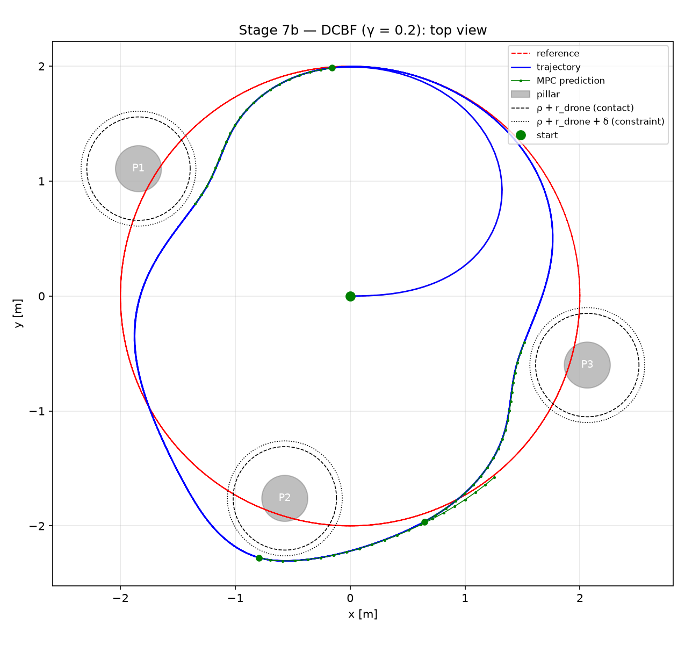
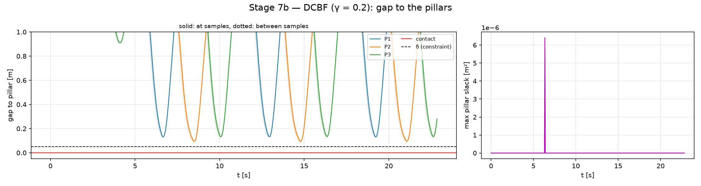
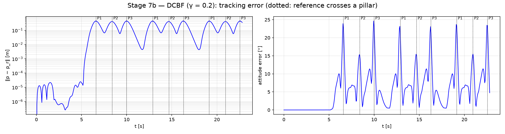
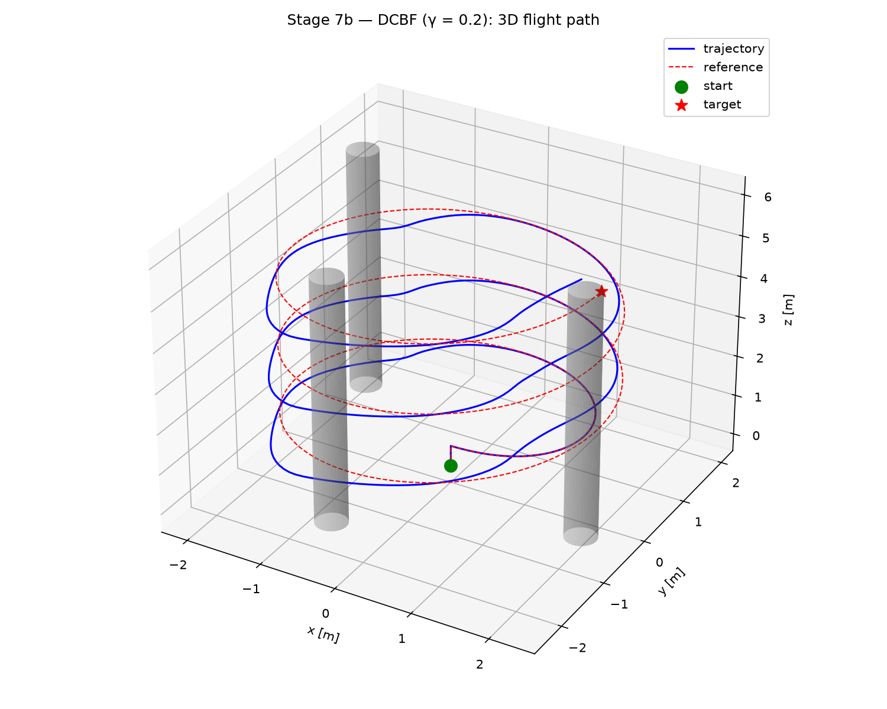
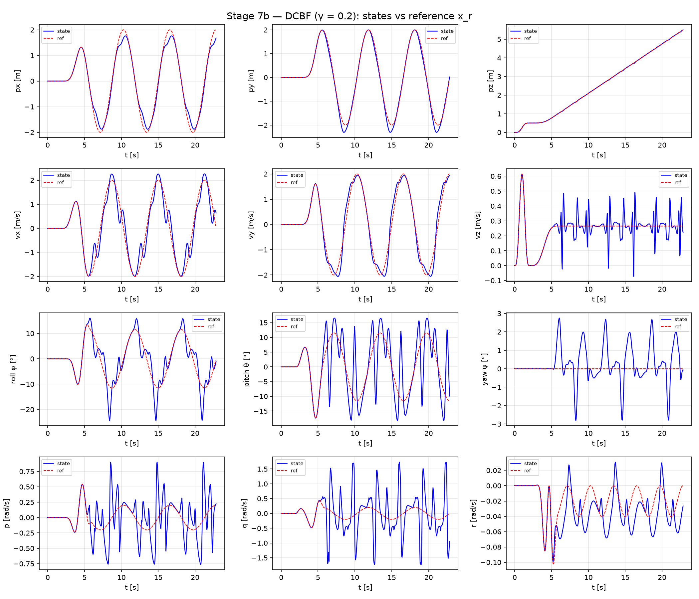
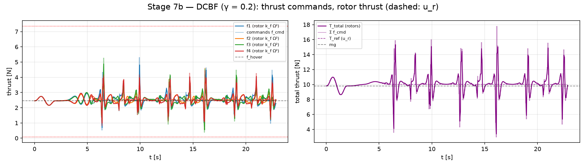
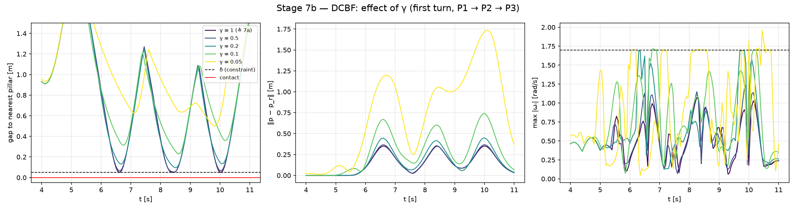

# Stage 7b — Obstacle Avoidance with a Discrete-Time Control Barrier Function

Stage 7a keeps the quadrotor out of the pillars with the distance constraint $h_j(p_i) \ge 0$. That
constraint does nothing until a predicted node reaches the constraint circle. Then the quadrotor
swerves as hard as the rate bound allows. This stage keeps the scene, the closed loop and the cost of
7a. It replaces only the obstacle constraint by a **discrete-time control barrier function
(DCBF)**, which limits how fast the quadrotor may approach an obstacle, not only how close it may
get.

| | |
|---|---|
| Git tag | `stage7` (13-state model; tag `rigid-body` = all stages before the motor dynamics) |
| Scene, plant, feedback | as Stage 7a: Stage 6 helix through three pillars, motor-dynamics model, nominal rotor-speed plant, full state feedback |
| Horizon / solver | $N = 20$, $T = 1$ s, $T_s = 0.05$ s; acados `SQP_RTI`, ERK4 (2 steps), projected shifted warm start |
| Obstacle constraint | $`h_j(x_{i+1}) \ge (1-\gamma)\, h_j(x_i)`$, $i = 0, \dots, N-1$, soft |
| Main run | $\gamma = 0.2$ |
| Entry point | `./run.sh stage7_obstacle/simulate_obst_dcbf.py [--sweep]` → `results/stage7b_obst_dcbf/` |

---

## 1. From a distance constraint to a barrier function

$h_j$ is the same function as in 7a: the squared horizontal distance to the axis of pillar $j$ minus
$r_{\text{safe},j}^2$, with $r_{\text{safe}} = \rho + r_{\text{drone}} + \delta$. The safe set is
$`\mathcal C_j = \{x : h_j(x) \ge 0\}`$.

The DCBF condition of Zeng, Zhang & Sreenath (2021) is

```math
h_j(x_{i+1}) \;\ge\; (1-\gamma)\, h_j(x_i), \qquad 0 < \gamma \le 1 .
```

- **Forward invariance.** By induction, $`h_j(x_i) \ge (1-\gamma)^i h_j(x_0) \ge 0`$. Any input
  that satisfies the condition keeps a state inside $\mathcal C_j$ inside it. The condition is
  imposed from $i = 0$ on, so it filters the **applied** input $u_0$.
- **Decay rate.** $h_j$ may shrink by at most the fraction $\gamma$ per sample. $\gamma = 1$ allows
  any decrease down to $h_j = 0$: this is exactly the 7a constraint. A smaller $\gamma$ requires a
  slower approach.
- **When it becomes active.** Far from the pillar, $h_j \approx d^2$ with $d$ the distance to the
  axis. Approaching at speed $v$, $h_j$ falls by about $2 v T_s / d$ per sample, so the condition
  binds once

```math
d \;\lesssim\; \frac{2\, v\, T_s}{\gamma}
\qquad (v = 2 \text{ m/s}: \;\; \gamma = 0.5 \to 0.4 \text{ m}, \;\; \gamma = 0.2 \to 1 \text{ m}, \;\; \gamma = 0.1 \to 2 \text{ m}, \;\; \gamma = 0.05 \to 4 \text{ m}) .
```

  This distance does not depend on the horizon. For $\gamma = 0.5$ it lies inside
  $r_{\text{safe}} = 0.5$ m, so the estimate breaks down there; near the circle $h_j = d^2 - r^2$
  falls faster, and the condition binds only in the final approach.

## 2. Implementation (`ocp_config_obstacle.py`, `gamma=`)

**Two nodes in one constraint.** An acados constraint sees one node $(x_i, u_i)$, but the DCBF
couples $x_i$ and $x_{i+1}$. The next state is therefore written *inside* the constraint as the RK4
step $F$ over $T_s$:

```math
c_j(x_i, u_i) \;=\; h_j\big(F(x_i, u_i)\big) - (1-\gamma)\, h_j(x_i) \;\ge\; 0,
\qquad i = 0, \dots, N-1 .
```

$F$ (`rk4_step(model, Ts, n_steps=2)`) is built from `model.f_expl_expr` and is the same
discretization the OCP uses: ERK, 4 stages, **two** steps per interval on the thrust-lag model,
because $\tau_m = 30$ ms is shorter than $T_s$. On a converged, defect-free trajectory
$`h_j(F(x_i, u_i)) = h_j(x_{i+1})`$ exactly. With a single RK4 step the lag would be integrated with
the factor 0.27 instead of $e^{-T_s/\tau_m} = 0.19$, and the DCBF would constrain a different
$x_{i+1}$ than the one the OCP predicts.

| Theory | acados |
|---|---|
| row on $u_0$ (the safety filter) | `con_h_expr_0` = $c(x, u)$, `lh_0 = 0`, `uh_0 = ACADOS_INFTY`, `idxsh_0` |
| rows $i = 1 \dots N-1$ | `con_h_expr` = $c(x, u)$ |
| no terminal row | $`h_j(x_N) \ge (1-\gamma) h_j(x_{N-1})`$ is the $i = N-1$ row |
| slacks | stage 0 has no $\lvert\omega\rvert$ slack, so `zl_0` holds only the pillar weights; stages $1 \dots N-1$ append them after the $\lvert\omega\rvert$ slacks |
| one solver per $\gamma$ | model name `quadrotor_obst_dcbf_g0p2` etc., so several $\gamma$ can run in one process |

`create_solver(pillars, ..., gamma=None)` builds 7a, and `gamma=γ` builds 7b. The closed loop
`closed_loop.simulate(gamma=)` is shared, including the warm start that projects guess nodes
onto the constraint circles.

**Check against 7a.** With $\gamma = 1$ the DCBF form must reproduce the distance constraint. It
does: minimum gap 50.0 mm, slack $4 \cdot 10^{-13}$ m², the same tracking error (176 / 351 mm; sweep
table, [§5](#5-effect-of-gamma---sweep)). It is
written differently — $h_j$ of an RK4 step on nodes $0 \dots N-1$ instead of $h_j$ of the state on
nodes $1 \dots N$ — so this also checks the RK4-in-constraint construction.

## 3. What changes compared with 7a

- **No inner approximation.** In 7a, $h_j$ is convex in $p$, so its linearization is a half-plane
  inside the free space and every QP iterate is collision-free at the nodes. $c_j$ is a difference
  of two convex functions composed with the dynamics, so this property is lost: only a converged
  solution satisfies it. In the closed loop the condition
  $`h_j(x_{k+1}) \ge (1-\gamma) h_j(x_k)`$ was nevertheless never violated by more than
  $10^{-3}$ m², for any $\gamma$ of the sweep on the 13-state model, and by at most
$2 \cdot 10^{-5}$ m² in the main run on the motor model.
- **Feasibility.** A small $\gamma$ requires an early, slow approach. If the state is already
  approaching too fast, no input can meet the decay rate in time. The soft slack — the relaxation
  that Zeng et al. propose for this — keeps the QP solvable.
- **Larger multipliers.** With the 7a weight $z_1 = 10^4$ the rows at the far end of the horizon
  took slack, up to 0.3 m² at $\gamma = 0.05$. The DCBF binds over many nodes against the pull of
  the tracking cost, so its multipliers exceed $z_1 T_s = 500$. With $z_1 = 10^5$ (`Z_L1_DCBF`) the
  slack is at solver tolerance ($10^{-12}$) for $\gamma \in \{1, 0.5, 0.1\}$, $6 \cdot 10^{-6}$ m² at
  $\gamma = 0.2$ and $8 \cdot 10^{-4}$ m² at $\gamma = 0.05$ (motor model).

## 4. Main run, $\gamma = 0.2$

All figures are in `results/stage7b_obst_dcbf/`.

| Metric | 7b, $\gamma = 0.2$ | 7a |
|---|---|---|
| failed OCP calls | 0 / 457 | 0 / 457 |
| min gap at samples / between samples | 94.1 / 93.1 mm | 50.0 / 47.4 mm |
| min gap per pillar P1 / P2 / P3 | 132 / 94 / 134 mm | 50 / 50 / 50 mm |
| max pillar slack | $6 \cdot 10^{-6}$ m² | $5 \cdot 10^{-12}$ m² |
| avoidance starts before the first crossing ($\lVert p - p_r \rVert > 1$ cm) | 0.90 s | 0.90 s |
| node-0 row active (closed loop, condition $< 10^{-3}$ m²) | 14.7 % of samples | 3.3 % |
| $\lVert p - p_r \rVert$ RMS / max | 217 / 449 mm | 176 / 351 mm |
| max $\lvert\omega\rvert$ / samples at the bound (1.7 rad/s) | 1.73 rad/s / 4.1 % | 1.02 rad/s / 0 % |
| largest one-sample change of a body rate | 1.33 rad/s | 0.71 rad/s |
| max tilt | 26.8° | 26.4° |
| thrust commands | $`[0.39,\, 5.30]`$ N | $`[2.07,\, 5.22]`$ N |
| MPC time mean / p99 / max | 9.8 / 16.3 / 25.6 ms | 8.7 / 15.2 / 21.8 ms |

Wall-clock times vary between runs: one run of the same $\gamma = 0.2$ problem reported 28 ms mean
and 117 ms max with an identical solution (same slack to the last digit), the repeat 9.8 ms.

**What changed with the motor model.** On the 13-state model the DCBF at $\gamma = 0.2$ also made
the flight *smoother* than 7a (largest rate change 0.97 against 1.62 rad/s, 7a at the rate bound in
1.5 % of the samples). On the motor model 7a itself swerves gently — its rates stay at 1 rad/s —
and the DCBF's wider swerve needs *more* rate (1.33 rad/s, 4 % at the bound). What the DCBF still
buys is clearance: 94–134 mm instead of exactly 50 mm.

### 4.1 Top view

<p align="center">
  
</p>

The quadrotor passes on the same sides as in 7a, but the path no longer runs along the dotted
constraint circles: it stays 44–84 mm farther out (flown radius 1.56 / 2.41 m at the crossings,
7a: 1.65 / 2.35 m). The green curves are the
predictions of the solve that comes closest to each pillar.

### 4.2 Gap to the pillars



The gap never reaches $\delta$. It approaches its minimum smoothly, without the flat contact
phase of 7a, because $h_j$ may only decay geometrically. P2, the pillar passed on the outside of the
helix, comes closest (94 mm). P1 and P3 keep about 133 mm. The slack stays below $10^{-5}$ m².

### 4.3 Tracking error



The deviation is about 25 % larger than in 7a (peaks 0.42–0.45 m against 0.35 m), but it starts at
the same time, 0.9 s before the first crossing. On the 13-state model it started 0.25 s earlier;
here the horizon, not γ, still sets the start at $\gamma = 0.2$. The attitude error peaks at about
25° (7a: 16°): the wider swerve needs more lateral acceleration.

### 4.4 Flight path, states and motor thrusts

<p align="center">
  
</p>





The states look like those of 7a with wider swerves. The thrust commands reach down to 0.4 N in
the hardest part of the swerves (7a: 2.1 N), but never hit a limit.

## 5. Effect of $\gamma$ (`--sweep`)

`python -m stage7_obstacle.simulate_obst_dcbf --sweep` runs $\gamma \in \{1, 0.5, 0.2, 0.1, 0.05\}$ on the same scene:

| $\gamma$ | min gap [mm] | max slack [m²] | avoidance starts before P1 [s] | $\lVert p - p_r \rVert$ RMS / max [mm] | max $\lvert\omega\rvert$ [rad/s] | samples at the rate bound | max tilt |
|---|---|---|---|---|---|---|---|
| 1 (≙ 7a) | 50.0 | $4 \cdot 10^{-13}$ | 0.90 | 176 / 351 | 1.08 | 0 % | 26.7° |
| 0.5 | 52.7 | $3 \cdot 10^{-13}$ | 0.95 | 181 / 367 | 1.24 | 0 % | 26.9° |
| 0.2 | 94.1 | $6 \cdot 10^{-6}$ | 0.90 | 217 / 449 | 1.73 | 4.1 % | 26.8° |
| 0.1 | 229.2 | $7 \cdot 10^{-13}$ | 1.50 | 346 / 741 | 1.72 | 5.0 % | 31.5° |
| 0.05 | 500.3 | $8 \cdot 10^{-4}$ | 3.35 | 854 / 1734 | 1.96 | 19.4 % | 35.0° |

All runs: 0 failed solves, MPC 10–14 ms per call on average. On the 13-state model (tag `stage7`)
the same sweep gave min gaps of 50 / 53 / 85 / 211 / 359 mm and 1.5 / 0 / 4.4 / 16.6 / 36 % of the
samples at its 1.8 rad/s bound.



- **Farther — as designed; earlier only for small $\gamma$.** The smaller $\gamma$, the larger the
  gap: 50 → 53 → 94 → 229 → 500 mm. The avoidance starts earlier only below $\gamma = 0.2$
  (1.5 s at $\gamma = 0.1$, 3.4 s at $\gamma = 0.05$); down to $\gamma = 0.2$ the 1 s horizon still sets
  the start, because the activation distance $2 v T_s / \gamma \le 1$ m is not longer than the horizon.
- **Not gentler on the motor model.** The 7a flight ($\gamma = 1$) is already gentle here: body
  rates up to 1.08 rad/s, never at the 1.7 rad/s bound. Every smaller $\gamma$ needs *more* rate,
  because the swerve gets wider: 1.24 rad/s at $\gamma = 0.5$, the bound in 4–5 % of the samples at
  $\gamma = 0.2$ and 0.1, in 19 % at $\gamma = 0.05$, with tilts up to 35°. On the 13-state model,
  where the 7a swerve itself was abrupt, $\gamma = 0.5$ was the softest setting; that effect is gone.
- **Small $\gamma$ is conservative in this scene.** At $\gamma = 0.05$ the activation distance is
  4 m, the diameter of the helix: the condition binds for all three pillars most of the time, the
  quadrotor is pushed away from every pillar at once while the tracking cost pulls it along the
  circle, and the tracking error reaches 1.7 m.
- **$\gamma = 0.2$** (main run) nearly doubles the margin to the pillars at a moderate cost in
  tracking error and rate; $\gamma = 0.5$ is practically the 7a flight.

## 6. Observations and limitations

- **Relative degree.** $h_j$ depends on position only. On the motor model $u_0$ is a thrust
  *command*: it changes $p_1$ only through the thrust lag ($f_{\text{cmd}} \to f \to \dot v \to p$),
  one integration more than on the 13-state model, and only through the thrust magnitude; the
  attitude, which turns the thrust, is a state and needs further samples to change. The node-0 row is therefore almost a condition on the current state. It
  stays satisfiable only because the rows at the later nodes plan the approach ahead. A barrier
  with the velocity in it — a high-order CBF (Xiao & Belta, 2022) — acts on the input directly. It
  is not implemented here.
- **No certificate beyond the horizon.** Forward invariance holds for inputs that satisfy the
  condition. Whether the OCP stays feasible is not certified (no terminal set), as in 7a. The slack
  hides an infeasible step instead of failing.
- **One $\gamma$ for all pillars and all distances.** The activation distance scales with $1/\gamma$
  and with the approach speed. In a denser scene, or at higher speed, $\gamma$ has to grow to keep
  the condition from binding everywhere.
- **Nominal, full state,** as 7a. With an estimator, $h_j(\hat x)$ instead of $h_j(x)$ is filtered.
  The margin needed for that is a robust-MPC question.

## Files

| File | Role |
|---|---|
| `ocp_config_obstacle.py` | `dcbf_pillars()` (with `rk4_step(..., n_steps=2)` from `core/integrators.py`); `add_pillar_constraints(..., gamma=)` and `create_solver(..., gamma=)` build the DCBF form; `Z_L1_DCBF`; `obstacle_slack(..., dcbf=True)` |
| `simulate_obst_dcbf.py` | main run ($\gamma = 0.2$) and `--sweep`; metrics `swerve_lead()`, `sweep_row()`, `print_sweep()` |
| `closed_loop.py` | scene and closed loop shared with Stage 7a: `simulate(gamma=)`, `summarize()`, `make_figures()` |
| `plot_utils.py` | `plot_dcbf_sweep()` (new) |

```bash
./run.sh stage7_obstacle/simulate_obst_dcbf.py  # γ = 0.2   → results/stage7b_obst_dcbf/
./run.sh stage7_obstacle/simulate_obst_dcbf.py --sweep  # γ sweep   → results/stage7b_obst_dcbf/gamma_sweep.png
```

The 13-state version from its tag:

```bash
git checkout stage7
./run.sh simulate_obst_dcbf.py
```

## References

- J. Zeng, B. Zhang, K. Sreenath, "Safety-critical model predictive control with discrete-time
  control barrier function," *American Control Conference (ACC)*, 2021.
- J. Zeng, Z. Li, K. Sreenath, "Enhancing feasibility and safety of nonlinear model predictive
  control with discrete-time control barrier functions," *IEEE Conference on Decision and Control
  (CDC)*, 2021.
- W. Xiao, C. Belta, "High-order control barrier functions," *IEEE Transactions on Automatic
  Control* 67(7), 2022.
- A. D. Ames, S. Coogan, M. Egerstedt, G. Notomista, K. Sreenath, P. Tabuada, "Control barrier
  functions: theory and applications," *European Control Conference (ECC)*, 2019.
