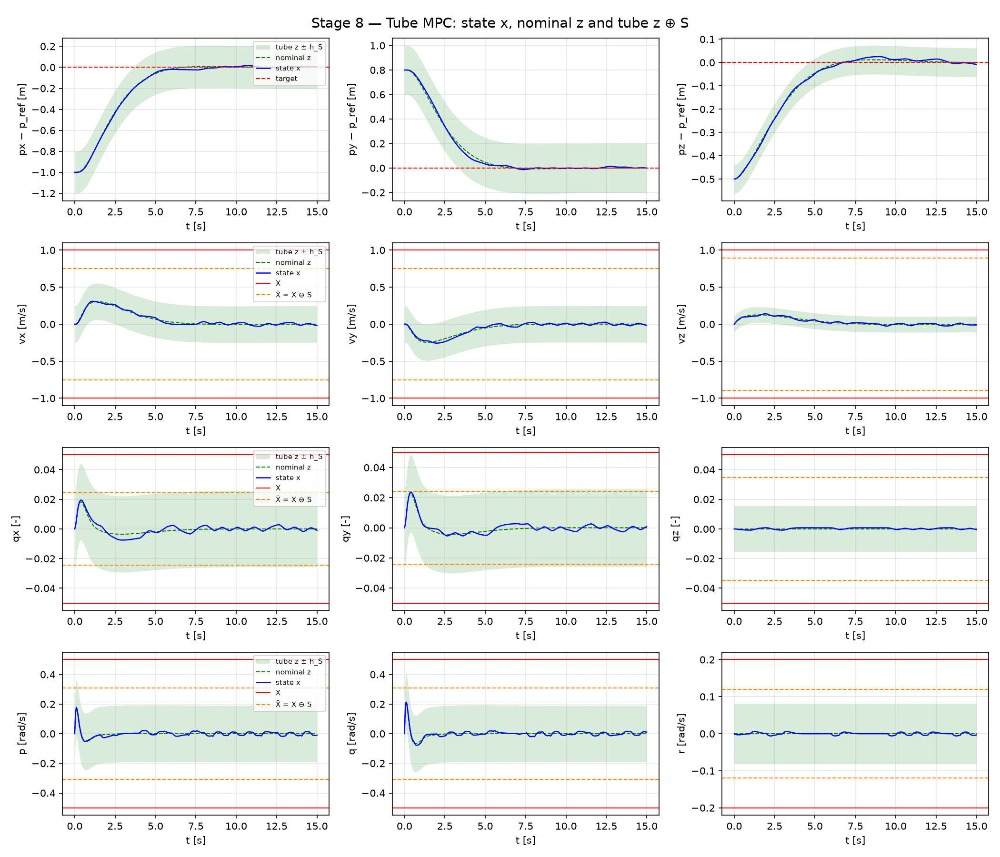
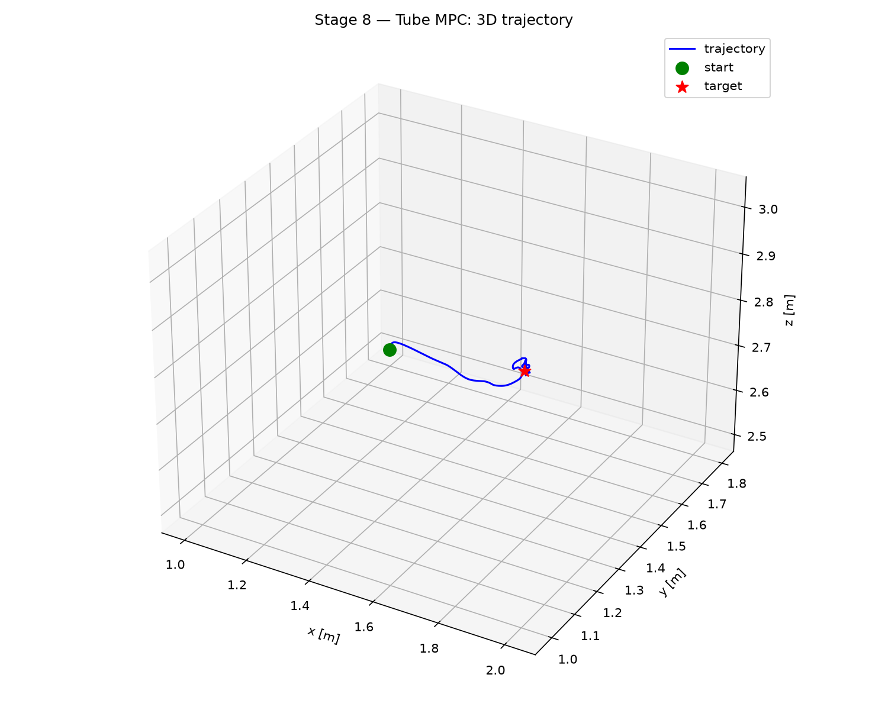

# Stage 8 — Robust Tube MPC around a Hover Point

Stages 1–7 give no guarantee once the model is wrong: the constraints hold for the *prediction*,
and the true state can still leave them. This stage implements **tube-based robust MPC** for a
linear system with a bounded additive disturbance (Mayne, Seron & Raković, 2005; Rawlings, Mayne &
Diehl, §3.5). The controller regulates the quadrotor to a hover point. The plant is the
**nonlinear** quadrotor with rotor-speed dynamics (ESC speed loop, $f = k_f \Omega^2$). The linear
tube MPC "sees" it as

```math
x^+ = A x + B u + w, \qquad w \in \mathbb W,
```

where $w$ contains everything the linear model gets wrong: the force/torque disturbance $d$, the
rigid-body linearization error **and** the error of the linear thrust lag against the nonlinear
rotor loop. The tube then guarantees that the state and input constraints hold for the real
nonlinear plant at every sample, for every disturbance in the set $\mathbb D$. The one caveat is
that $\mathbb W$ is a sampled bound ([§2](#2-from-the-nonlinear-quadrotor-to-x--ax--bu--w)).

The controller is the **linear** tube MPC, unchanged: linear model, linear error feedback, a tube
of constant cross-section. The nonlinearity enters in one place only, the size of $\mathbb W$. No
nonlinear robust MPC theory is used.

| | |
|---|---|
| Prediction model | hover linearization of the thrust-lag model [x; f], $\dot q_w$ row removed (16 states), ZOH at $T_s = 0.05$ s |
| Plant | `create_rotor_plant(Ts)` — rotor speeds, ESC loop, $f = k_f \Omega^2$, ERK4 (4 steps), $d(t) \in \mathbb D$ time-varying |
| Feedback | full state (thrust states included) |
| Horizon | $N = 80$, $T = 4$ s |
| Solver | acados `SQP`, exact Hessian, `PARTIAL_CONDENSING_HPIPM`, `DISCRETE` dynamics |
| Offline | `compute_tube_params.py` → `data/tube_params.npz` |
| Entry point | `./run.sh stage8_tube/simulate_tube.py` → `results/stage8_tube/` |
| Git tag | `stage8` (13-state model; tag `rigid-body` = all stages before the motor dynamics) |

---

## 1. Tube MPC in one page

For $x^+ = Ax + Bu + w$, $w \in \mathbb W$, with constraints $x \in \mathbb X$, $u \in \mathbb U$, the
controller has two parts:

```math
\begin{aligned}
\text{nominal system} \quad & z^+ = A z + B v, \qquad z_0 = x_0
\\ \text{ancillary law} \quad & u = v + K (x - z) .
\end{aligned}
```

The error $e = x - z$ obeys $e^+ = (A + BK) e + w = A_K e + w$, and $e_0 = 0$. So for every
disturbance sequence

```math
e_k \in F_k = \bigoplus_{i=0}^{k-1} A_K^i \mathbb W \;\subset\; S_K(\infty) = \bigoplus_{i=0}^{\infty} A_K^i \mathbb W ,
```

the **minimal robust positively invariant (mRPI) set**. The true state lies in a tube of fixed
cross-section around the nominal trajectory, $x_k \in z_k \oplus S$. If the *nominal* system
satisfies the tightened constraints

```math
z \in \bar{\mathbb X} = \mathbb X \ominus S, \qquad v \in \bar{\mathbb U} = \mathbb U \ominus K S ,
```

then $x \in \mathbb X$ and $u \in \mathbb U$ for every $w$. The nominal system has no disturbance,
so an ordinary MPC on it, with terminal ingredients for $(\bar{\mathbb X}, \bar{\mathbb U})$, is
recursively feasible and drives $z \to 0$. Hence $x \to S$. Mixed state–input rows
$Cx + Du \le b$ are tightened the same way, by the support function of $(C + DK)S$.

The disturbance is handled in two places. Offline, the tube $S$ is computed once and the constraints
are shrunk by it. Online, the feedback $K(x - z)$ keeps the state inside the tube, and the MPC only
plans the nominal trajectory.

## 2. From the nonlinear quadrotor to x⁺ = Ax + Bu + w

### Coordinates

The deviation from the target hover point $(p_{\text{ref}}, v = 0, q = 1, \omega = 0, f = f_{\text{hover}})$:

```math
x = \big[\, p - p_{\text{ref}},\; v,\; q_x, q_y, q_z,\; \omega,\; f - f_{\text{hover}} \,\big] \in \mathbb R^{16}, \qquad
u = f_{\text{cmd}} - f_{\text{hover}} \in \mathbb R^4 .
```

$f$ are the four rotor thrusts, which lag the commands, $\dot f = (f_{\text{cmd}} - f)/\tau_m$ with
$\tau_m = 30$ ms. $q_w$ is dropped, as in the DARE terminal cost of Stage 2b. It is uncontrollable in
the linearization and follows from $\lVert q \rVert = 1$. $(A, B)$ is the ZOH discretization of
`get_thrust_lag_hover_linearization()`. The thrusts are part of the state, so the ancillary law
feeds them back as well. Here they are known exactly. With an estimator (Stage 4), the estimation
error becomes a second tube ([§9](#9-observations-and-limitations)).

### The disturbance set is a model-error set

Define $w$ as the difference between one plant step and the linear prediction:

```math
w(x, u, d) = F(x, u, d) - A x - B u ,
```

with $F$ = one step of the rotor plant (RK4, 4 substeps, in rotor speeds $\Omega$, mapped back to
thrusts by $f = k_f \Omega^2$), followed by the quaternion normalization. That is exactly what the
simulation does. $w$ collects

- the disturbance $d$ (force in $\dot v$, torque in $\dot\omega$),
- the thrust-tilt coupling $\delta T \cdot q$ (thrust changes and tilt multiply),
- the gyroscopic terms $\omega \times I \omega$,
- the kinematic coupling of roll/pitch rates and tilt into $q_z$,
- the **rotor loop** against the linear thrust lag (below),
- RK4 versus ZOH, and the normalization.

$\mathbb W$ is the componentwise bound $\lvert w_j \rvert \le \bar w_j$ over $\mathbb X \times \mathbb U
\times \mathbb D$. The tube MPC keeps $x \in \mathbb X$ and $u \in \mathbb U$, so the bound holds
along the closed loop. This is not circular: the sets are fixed first, and the guarantee keeps the
state inside them.

### The rotor loop and the command lead

The plant's speed loop is $\dot\Omega = (\Omega_{\text{cmd}} - \Omega)/\tau_m$ with
$`\Omega_{\text{cmd}} = \sqrt{f_{\text{cmd}}/k_f}`$. In thrusts,

```math
\dot f = 2 k_f \Omega \dot\Omega
= \frac{2\sqrt f \,\big(\sqrt{f_{\text{cmd}}} - \sqrt f\big)}{\tau_m}
= \frac{f_{\text{cmd}} - f}{\tau_m} - \frac{\big(\sqrt{f_{\text{cmd}}} - \sqrt f\big)^2}{\tau_m} .
```

The linear thrust lag of the MPC model is the first term. It misses a term **quadratic in the
lead** of the command over the thrust. With independent boxes for $f$ and $f_{\text{cmd}}$ the lead
reaches about 0.9 N per motor, the thrust residual $\bar w_f$ is 0.08 N per step, and the tube is
up to 2.1 times larger than the wrench boxes. No tube fits.

The remedy is a mixed state–input constraint on the lead, in wrench coordinates:

```math
\big\lvert M (u - \delta f) \big\rvert \le \Delta\bar\nu, \qquad \delta f = f - f_{\text{hover}} .
```

A slow regulator never needs a large lead, so the row costs little. $\Delta\bar\nu$ is 25 % of
$\mathbb U$ in $\delta T$ and $\tau_z$, and 60 % in $\tau_x, \tau_y$ (the tilt dynamics need the
torque). The sweep gave the largest tube share 1.20 / 1.08 / 1.00 at a uniform 25 / 30 / 40 % and
0.72 at this split. The thrust residual drops by a factor of 20, to 0.0036 N.

### Searching the maximum

The maximum is **searched, not proven**, in three steps:

1. all $2^{20}$ vertices of the $(q_v, \omega, \nu_f, \Delta\nu, d)$ box, with $\nu_f = M\delta f$
   the wrench of the thrust states and $\Delta\nu$ the command lead,
2. $2 \cdot 10^5$ uniform samples of the box,
3. a local maximization of each $\pm w_j$ over the box (IPOPT), started from the best vertex and
   the best random sample.

The result is multiplied by a margin of 1.1. In every component the random maximum stays 1–29 %
below the vertex maximum, as expected for a residual made of products of state and input. The local
maximization finds values at most 0.13 % above the best vertex, so the vertices are not exactly
the maximizers, and the margin covers the difference many times over. It is the same kind of
certificate as the Lipschitz check of Stage 2a.

Two assumptions go into it:

- $w$ does not depend on $p$ or $v$ (asserted numerically), so $\mathbb X$ needs no position bound
  and the search runs over 20 instead of 26 variables.
- $d$ and the command are constant over each sample.

The function that is bounded is the plant itself: it agrees with the acados plant step
(`create_rotor_plant`) to $2 \cdot 10^{-15}$ (`compute_tube_params.py --check`).

### The sets

| Set | Bound | |
|---|---|---|
| $\mathbb X$ | $`\lvert v_i \rvert \le 1`$ m/s, $`\lvert q_x \rvert, \lvert q_y \rvert \le 0.05`$ (5.7°), $`\lvert q_z \rvert \le 0.05`$, $`\lvert p \rvert, \lvert q \rvert \le 0.5`$ rad/s, $`\lvert r \rvert \le 0.2`$ rad/s; thrust states $`\lvert M \delta f \rvert \le`$ the box of $\mathbb U$ | position free |
| $\mathbb U$ | $`\lvert \delta T \rvert \le 0.6`$ N, $`\lvert \tau_x \rvert, \lvert \tau_y \rvert \le 0.05`$ N·m, $`\lvert \tau_z \rvert \le 0.012`$ N·m | box on the **wrench** $\nu = M u$ |
| lead | $`\lvert M(u - \delta f) \rvert \le (0.15,\ 0.03,\ 0.03,\ 0.003)`$ | mixed state–input row |
| $\mathbb D$ | $`\lvert d_{f,i} \rvert \le 0.05`$ N, $`\lvert d_{\tau,i} \rvert \le 5 \cdot 10^{-4}`$ N·m | light wind, CoG offset ≈ 0.5 mm |

**Why a wrench box.** With the motor box $0 \le f_i \le F_{\max}$, one sample with a full motor
step changes $\omega$ by about 2 rad/s, and $\delta T$ up to 20 N multiplies the tilt. The resulting
$\bar w$ is larger than $\mathbb X$ itself, and no tube fits. Bounding the wrench
$\nu = M u = [\delta T, \tau_x, \tau_y, \tau_z]$ (with $M$ = `MIXER`) directly limits both effects.
The box lies inside the motor box: $f_i \in [1.33, 3.58]$ N. The thrust states get the same box,
since $\delta T \cdot q$ is driven by the *actual* thrust.

**Why so small.** The linearization error grows *quadratically* with the size of
$\mathbb X \times \mathbb U$, the effect of $d$ does not. A larger tilt box gives more authority
against $d$ but a larger $\bar w$. The tilt, rate and $\delta T$ boxes come from a sweep that
minimized the largest tube share on the 13-state model ([§3](#3-the-tube-cross-section-s)). This is
regulation *around* the target, not aggressive flight.

| | $p$ | $v$ | $q_{x,y}$ | $q_z$ | $\omega_{x,y}$ | $r$ | $f_i$ |
|---|---|---|---|---|---|---|---|
| $\bar w$ from $d$ only | $6.3 \cdot 10^{-5}$ | $2.5 \cdot 10^{-3}$ | $3.1 \cdot 10^{-5}$ | $1.6 \cdot 10^{-5}$ | $2.5 \cdot 10^{-3}$ | $1.3 \cdot 10^{-3}$ | 0 |
| $\bar w$ sampled | $2.3 \cdot 10^{-4}$ | $9.8 \cdot 10^{-3}$ | $1.3 \cdot 10^{-3}$ | $1.7 \cdot 10^{-3}$ | $1.3 \cdot 10^{-2}$ | $1.3 \cdot 10^{-3}$ | $3.6 \cdot 10^{-3}$ |
| ratio | 3.7 | 3.9 | 42 | 108 | 5.2 | 1.0 | — |

The **linearization error dominates**: 3.7–5.2 times the effect of $d$ in $p, v, \omega$, and
40–110 times in the attitude. The thrust residual is pure model error (the rotor loop). Only the yaw
rate is almost pure $d$ (yaw torque is linear, and the gyroscopic term
$`(I_{xx} - I_{yy})\, p\, q`$ vanishes for $I_{xx} = I_{yy}$).

## 3. The tube cross-section S

### Only the support function is needed

The tightening $\mathbb X \ominus S$ of a box needs, for each row $c$, only the **support
function** $h_S(c) = \max_{e \in S} c^\top e$:

```math
\mathbb X \ominus S = \{ x : c_j^\top x \le b_j - h_S(c_j) \}.
```

The tube never has to be represented as a set. That matters here: an explicit polytope of the mRPI
set in 16 dimensions (Minkowski sums of a 16-dimensional box) is not computable in practice. For a
box $\mathbb W$, $h_{\mathbb W}(c) = \sum_j \lvert c_j \rvert \bar w_j$, and the support function of
the Minkowski sum is the sum of the support functions. The outer approximation of Raković,
Kerrigan, Kouramas & Mayne (2005),

```math
S = F(\alpha, s) = (1 - \alpha)^{-1} \bigoplus_{i=0}^{s-1} A_K^i \mathbb W \;\supseteq\; S_K(\infty),
\qquad A_K^s \mathbb W \subseteq \alpha \mathbb W ,
```

is itself RPI and has the closed-form support function

```math
h_S(c) = (1 - \alpha)^{-1} \sum_{i=0}^{s-1} \sum_j \big\lvert (c^\top A_K^i)_j \big\rvert \, \bar w_j .
```

For a box, $A_K^s \mathbb W \subseteq \alpha \mathbb W$ holds iff
$`\lvert A_K^s \rvert \bar w \le \alpha \bar w`$ row by row. With $\alpha = 0.01$ this gives $s = 132$.

The formula is tight: the disturbance sequence $`w_i = \bar w \circ \mathrm{sign}((A_K^i)^\top c)`$
drives $c^\top e$ to exactly $(1 - \alpha)\, h_S(c)$ after $s$ steps (checked by `--check` for 37
rows: the 16 axes, the 13 state-constraint rows, the 4 command-wrench rows and the 4 lead rows).

$S$ is a zonotope with $16 s = 2112$ generators and is far from a box: a point at 20 % of every axis
bound $h_S(e_j)$ can lie outside it. Membership is therefore tested exactly, by the gauge

```math
\gamma(e) = \min \{\, t : e \in t\, S \,\}, \qquad e \in S \iff \gamma(e) \le 1 ,
```

a linear program in the generator coefficients (`tube_gauge`).

### Explicit tube shapes were too conservative

Before settling on the support function, explicit RPI sets were tried on the 13-state model (tag
`rigid-body`). Mayne et al. (2005) need one for the variant with a free initial nominal state
([§9](#9-observations-and-limitations)):

- an **ellipsoid** $`\{ e^\top P e \le 1 \}`$ with $K$ and $P$ from one LMI (S-procedure over the box
  $\mathbb W$, feedback $K e$ limited to a share of $\mathbb U$, contraction rate $\lambda$ from
  0.8 to 0.99). With a 50 % share the LMI is infeasible for every $\lambda$. With 70 % and 90 % an
  ellipsoid exists but is 2.4 and 1.4 times the state bounds, so it does not fit into $\mathbb X$;
- a **modal box** (intervals and discs in the eigen-coordinates of $A_K$, RPI in closed form):
  1.3 to 4.6 times the mRPI set along the axes, 1.75 times the bounds.

The mRPI support function is the tightest choice for a given $K$ and $\mathbb W$, and it was the only
one that left room for the nominal trajectory. The 16-state model only adds dimensions.

### The ancillary gain K

$K$ is an LQR gain on the command wrench, $(A, B M^{-1})$, with weights normalized by the bounds:

```math
Q = \mathrm{blkdiag}\Big( \mathrm{diag}\big(q_{\text{pos}} \mathbf 1_3,\; 0.3 \cdot \mathbf 1_3,\; q_{\text{att}} \mathbf 1_3,\; 0.1 \cdot \mathbf 1_3\big) / s^2,\;\;
M^\top \mathrm{diag}(0.1 / \bar\nu_f^2)\, M \Big),
\qquad R = r / \bar\nu^2 ,
```

where $s$ holds the state bounds (0.5 m for position). A 27-point grid over
$(r, q_{\text{att}}, q_{\text{pos}})$ is searched. The point whose tube occupies the smallest share of
any constraint row wins: $(0.3, 1, 1)$, with $\rho(A_K) = 0.951$.

$K$ and the nominal-MPC cost have different jobs. $K$ keeps $e$ small against every
$w \in \mathbb W$. The MPC moves $z$ to the target.

### Result: tube and tightened sets

| | $v_{x,y}$ | $v_z$ | $q_{x,y}$ | $q_z$ | $\omega_{x,y}$ | $r$ |
|---|---|---|---|---|---|---|
| bound | 1.0 | 1.0 | 0.05 | 0.05 | 0.5 | 0.2 |
| $h_S$ (tube) | 0.347 | 0.169 | 0.0358 | 0.0237 | 0.257 | 0.090 |
| share | 0.35 | 0.17 | **0.72** | 0.47 | 0.51 | 0.45 |
| tightened | 0.653 | 0.831 | 0.0142 | 0.0263 | 0.243 | 0.110 |

| wrench rows | $\delta T$ | $\tau_{x,y}$ | $\tau_z$ |
|---|---|---|---|
| commands $\mathbb U$: bound / $h_{KS}$ / share / tightened | 0.6 / 0.329 / 0.55 / 0.271 | 0.05 / 0.019 / 0.38 / 0.031 | 0.012 / 0.0051 / 0.43 / 0.0069 |
| thrust states: bound / $h_S$ / share / tightened | 0.6 / 0.345 / 0.57 / 0.255 | 0.05 / 0.020 / 0.39 / 0.031 | 0.012 / 0.0051 / 0.43 / 0.0069 |
| lead: bound / $h$ / share / tightened | 0.15 / 0.076 / 0.51 / 0.074 | 0.03 / 0.019 / 0.62 / 0.011 | 0.003 / 0.0021 / **0.69** / 0.0009 |

The position cross-section is $\pm 0.28$ m horizontally and $\pm 0.14$ m vertically. The tube takes up
to 72 % of a bound (the tilt): the tightened tilt is only 1.6°.

## 4. Nominal MPC and terminal ingredients

```math
\begin{aligned}
\min_{v_0, \dots, v_{N-1}} \quad & \sum_{i=0}^{N-1} \ell(z_i, v_i) + \lVert z_N \rVert_{P_f}^2,
\qquad \ell(z, v) = z^\top Q z + 2 z^\top S v + v^\top R v
\\ \text{s.t.} \quad & z_{i+1} = A z_i + B v_i, \qquad z_0 = z_k \quad \text{(the nominal state)}
\\ & z_i \in \bar{\mathbb X}, \quad i = 1, \dots, N-1, \qquad M v_i \in \bar{\mathbb U}, \quad
\lvert M (v_i - \delta f_i) \rvert \le \Delta\bar\nu - h, \quad i = 0, \dots, N-1
\\ & z_N^\top P_f z_N \le \alpha_f
\end{aligned}
```

- **Cost.** Bryson's rule on the *tightened* sets, plus the lead:
  $`Q = \mathrm{blkdiag}(1/(1\,\text{m})^2,\; 1/\bar x_j^2,\; M^\top \mathrm{diag}(1/\bar\nu_f^2) M) + E_f^\top G E_f`$,
  $`R = M^\top \mathrm{diag}(1/\bar\nu^2)\, M + G`$, $S = -E_f^\top G$, with
  $`G = M^\top \mathrm{diag}(1/\Delta\bar\nu^2) M`$ and $E_f$ the selector of $\delta f$. The lead
  term is $\lVert M(v - \delta f) \rVert^2_{\mathrm{diag}(1/\Delta\bar\nu^2)}$ written out. Without it the
  DARE gain $K_f$ leads the thrust states freely, and the terminal ellipsoid has to shrink to 2 cm
  to keep $M(K_f - E_f) z$ inside the tightened lead box (0.0009 N·m in yaw). With it, the lead rows
  stop being the bottleneck.
- **Terminal set.** $P_f$ and $K_f$ come from the DARE of the nominal cost (with the cross term
  $S$), so $V_f(z^+) - V_f(z) = -\ell(z, K_f z)$ under $v = K_f z$ and every sublevel set is
  invariant. $\alpha_f$ is the largest level with the ellipsoid inside $\bar{\mathbb X}$,
  $M K_f z \in \bar{\mathbb U}$ and $M(K_f - E_f) z$ inside the tightened lead box, in closed form
  (the support function of an ellipsoid). Result: $\alpha_f = 1.71$, semi-axes 0.21 m in position and
  0.11 m/s in velocity.
- **Horizon.** The tightened tilt of 1.6° allows about 0.28 m/s² of lateral acceleration. A
  rest-to-rest move of 1.3 m then takes about 4 s. The feasibility of the first OCP was checked with
  CVXPY + Clarabel for $N = 60, 80, 100, 120$: $N = 60$ (3 s) is infeasible, $N = 80$ (4 s) is
  feasible and is used. On the 13-state model the tightened tilt was 2.8° and $N = 60$ sufficed.
- **Recursive feasibility** is the nominal argument. The nominal model is exact for $z$, so the
  shifted solution with $v_N = K_f z_N$ is feasible at the next sample. If a solve does not
  converge, the controller applies exactly this candidate (`shifted_candidate`), and the
  guarantee does not depend on the solver. In the run it was never needed.

## 5. Mapping to acados

| Theory | acados |
|---|---|
| $z^+ = A z + B v$ | `integrator_type = 'DISCRETE'`, `disc_dyn_expr` — the very $(A, B)$ of $\mathbb W$ |
| $\ell$, $V_f$ | `LINEAR_LS`, $y = [z; v]$, `yref = 0`, `W = [[Q, S], [Sᵀ, R]]`; terminal `W_e = P_f` |
| no step-length scaling | `cost_scaling = 1` on every node — the default ($T_s$ on the stage cost) would break $V_f(z^+) - V_f(z) \le -\ell$ |
| $z_0 = z_k$ | `constraints.x0` |
| $z_i \in \bar{\mathbb X}$ (axes) | `idxbx`, `lbx = −x̄`, `ubx = x̄` |
| $M v_i \in \bar{\mathbb U}$, $M \delta f_i \in \bar{\mathbb U}_f$, lead | general linear constraints, 12 rows: `C = [0; C_f; −C_f]`, `D = [M; 0; M]`, `lg/ug = ±[ν̄; ν̄_f; Δν̄ − h]` |
| $z_N \in \mathbb X_f$ | `con_h_expr_e` $= z^\top P_f z$, `uh_e = α_f`, `lh_e = −ACADOS_INFTY` |
| convex QCQP | `SQP` with `hessian_approx = 'EXACT'` (the constraint Hessian $2\mu P_f$), warm-started from the shifted plan |

On the 13-state model the first OCP was also solved with an independent conic solver (CVXPY +
Clarabel): same cost to 8 digits, trajectories within $4 \cdot 10^{-6}$. So the acados problem is the
one written in [§4](#4-nominal-mpc-and-terminal-ingredients), including the unit cost scaling and the
constraint at node 0.

**One-sided terminal bound.** With `lh_e = 0`, the lower bound $z^\top P_f z \ge 0$ is active at the
cold start $z = 0$ with zero gradient. Its multiplier enters the exact Hessian as $-2\mu P_f$, the
QP becomes non-convex and HPIPM stops with `MINSTEP` in the second SQP iteration. The fix is
`lh_e = −ACADOS_INFTY`.

## 6. Scenario

```
z_{k+1} = A z_k + B v*(z_k),         z_0 = x_0            nominal MPC, linear, no w
u_k     = f_hover + v*(z_k) + K (x_k − z_k)               ancillary feedback (thrust commands)
x_{k+1} = plant(x_k, u_k, d_k)                            rotor-speed plant, d_k ∈ D
```

- Target $p_{\text{ref}} = (2, 1, 3)$ m, start $p_{\text{ref}} + (-1.0, 0.8, -0.5)$ m (1.37 m away),
  at rest, rotors at hover speed.
- $d$ is piecewise constant: a random **vertex** of $\mathbb D$ every 0.5 s (seeded). That is the
  persistent worst-case sign pattern, not a gentle average.
- 15 s, 300 samples.

## 7. Results

All figures are in `results/stage8_tube/`; the numbers are printed by `summarize()`.

| Check | Value | Guarantee |
|---|---|---|
| failed OCP solves / shifted candidate used | 0 / 0 of 300 | |
| gauge $\max \gamma(e)$, every 5th sample | 0.21 | $\le 1$: $e \in S$ (exact) |
| $`\max \lvert e_j \rvert / h_S(e_j)`$, 16 axes | 0.18 (worst $p_z$) | $\le 1$: what $\mathbb X \ominus S$ uses |
| $`\max \lvert (M K e)_i \rvert / h_{KS,i}`$, 4 wrench rows | 0.20 | $\le 1$: what $\mathbb U \ominus K S$ uses |
| $`\max \lvert x_j \rvert / \mathbb X_j`$, 13 rows | 0.31 | $\le 1$: $x \in \mathbb X$ |
| $`\max \lvert z_j \rvert / \bar{\mathbb X}_j`$ | 1.00 | $\le 1$: $z \in \bar{\mathbb X}$ |
| $`\max \lvert \nu_i \rvert / \mathbb U_i`$ | 0.22 | $\le 1$: $u \in \mathbb U$ |
| $`\max \lvert M(u - \delta f)_i \rvert / \Delta\bar\nu_i`$ | 0.38 | $\le 1$: command lead |
| $`\max \lvert w_j \rvert / \bar w_j`$ | 0.88 (worst $r$) | $\le 1$: realized $w \in \mathbb W$ |
| thrust commands | $[2.39, 2.53]$ N | |
| $`\lVert p - p_{\text{ref}} \rVert`$, last 5 s | ≤ 42 mm | tube $\pm 0.28 / 0.28 / 0.14$ m |
| MPC time mean / max | 4 / 35 ms (wall-clock on WSL, varies between runs) | budget 50 ms |

### 7.1 State, nominal and tube



- The nominal (green, dashed) reaches the target in about 7 s. Its roll and pitch touch the
  tightened tilt bound $\bar{\mathbb X}$ (orange) at $t \approx 0.5$ s. That is the 1.00 in the
  table: the MPC uses all the room it has, and with 1.6° that is not much.
- The true state (blue) stays inside the green band $z \pm h_S$ everywhere, and far inside it: the
  largest error is 18 % of the cross-section. After the transient, $x$ keeps moving around the
  target because $d$ jumps between vertices, and the motion stays a fraction of the tube.
- The band crosses the orange line in the attitude and rate rows. That is expected:
  $z \in \bar{\mathbb X}$ only guarantees $z \pm h_S \subset \mathbb X$ (red), not
  $z \pm h_S \subset \bar{\mathbb X}$.

### 7.2 Wrench


At $t = 0$ the error is zero, so the applied wrench equals the nominal one. Afterwards the feedback
$K e$ makes up most of the input: the nominal is $\approx 0$ after 2 s and the applied wrench follows
the disturbance. The saw-tooth in $\delta T$ is the ancillary feedback answering each new vertex of
$d_{f,z}$ every 0.5 s. The commanded wrench uses at most 22 % of $\mathbb U$.

### 7.3 The inequalities behind the guarantee


- **Left**: the error against the tube. The curves are the shares along the axes (the thrust
  states $f$ in brown), the black dots the exact gauge $\gamma(e)$. The gauge lies above the axis
  shares, as it must, and stays below 0.22: $e \in S$ with a factor of 4–5 to spare.
- **Middle**: the realized one-step model error. The yaw-rate component sits at 0.88, close to
  $1/1.1$. Its $\bar w$ is almost pure $d$, and $d$ is always at a vertex, so only the margin
  separates it from the bound. $p$ and $v$ stay at 25 %, $q_v$ at 2 % and the thrust states near
  0 % of $\bar w$: the rotor-loop error is quadratic in the lead, and near hover the lead is small.
  The sampled bound is the worst case over all of $\mathbb X \times \mathbb U$, and this flight stays
  near hover.
- **Right**: the disturbance sign pattern.

### 7.4 Flight path, states, thrust commands

<p align="center">
  
</p>


## 8. Where the conservatism comes from

The guaranteed tube is about five times wider than the error ever was. Three bounds stack up:

1. **$\mathbb W$ is a box over all of $\mathbb X \times \mathbb U$.** The linearization error is
   state-dependent: zero at hover, largest at the corners. The box charges every sample with the
   corner value, which is 4–50× the realized value here, and far more for the thrust states (7.3).
2. **Every component at its worst, independently, at every step.** $h_S$ sums the worst case over
   all disturbance directions and all past samples. A realized $w$ is correlated and far from that.
3. **The worst case needs an adversary.** Random vertices of $\mathbb D$ excite the error, but not
   with the sign pattern that would be resonant for $A_K$.

That is the price of a guarantee for every admissible disturbance sequence. Item 1 is specific to
using a linear tube for a nonlinear plant. Tubes that scale with the state (nonlinear or
"homothetic" tubes) or a state-dependent bound on $w$ would shrink it. The motor model makes item 1
sharper: the rotor loop adds a residual that only exists away from hover, and the lead row is
there only to keep it bounded.

## 9. Observations and limitations

- **The motor model costs tilt.** On the 13-state model (thrusts as input) the tube took 51 % of
  the tilt bound, here 72 %. The extra states add residual and the thrust lag slows the feedback,
  so the tightened tilt drops from 2.8° to 1.6°, and the horizon has to grow from 3 to 4 s.
- **The nominal does not see the state.** In this form (Rawlings, Mayne & Diehl, §3.5) $z$ evolves
  on its own from $z_0 = x_0$. If $x$ drifts inside the tube, the MPC does not re-plan; the
  ancillary law alone corrects it. Mayne et al. (2005) make $z_0$ a decision variable with the
  constraint $x - z_0 \in S$, which re-centres the tube at every step. That needs an **explicit**
  representation of $S$. The ellipsoid and the modal box were too large ([§3](#3-the-tube-cross-section-s)), and the
  polytopic $F(\alpha, s)$ would need $16 s \approx 2100$ auxiliary variables in the OCP.
- **Searched, not proven.** $\mathbb W$ is the largest value found by $1.25 \cdot 10^6$ samples and
  a local maximization, times 1.1. A global maximum of a non-convex function is not certified this
  way, as in Stage 2a.
- **A small envelope.** Tilt ≤ 5.7°, body rates ≤ 0.5 rad/s, $\lvert \delta T \rvert \le 0.6$ N, a
  bounded command lead. Larger sets make the linearization error grow faster than the authority,
  and no tube fits. Robust MPC on the linear model is a method for regulation around an operating
  point.
- **Full state feedback, thrust included.** The ancillary law needs the rotor thrusts. Without rpm
  telemetry they come from an estimator (Stage 4), $x$ is not known, and the estimation error is a
  second tube around the estimate (output-feedback tube MPC; Mayne, Raković, Findeisen & Allgöwer,
  2006).
- **No offset-free action.** A constant $d$ leaves a steady error inside the tube. Stage 3's
  disturbance estimate would remove it, but then $d - \hat d$ is the disturbance the tube has to
  cover.

## Files

| File | Role |
|---|---|
| `compute_tube_params.py` | sets $\mathbb X, \mathbb U$, lead box, $\mathbb D$; `linear_model()`, `residual_function()`, `sample_w_bound()`, `select_gain()`, `tube_support()` ($h_S$ of $F(\alpha, s)$), `tube_gauge()` (exact $e \in S$), `nominal_cost()`, `terminal_set()`; `save/load_tube_params()`; `reduce_state()` / `embed_state()`; `self_test()` (`--check`). Transitional `*_rigid` helpers serve Stage 9 until it migrates |
| `ocp_config_tube.py` | nominal OCP: `create_solver()`, `solve_nominal()`, `shifted_candidate()`, `warm_start()`, `ancillary_input()` |
| `simulate_tube.py` | entry point: scenario, closed loop, `summarize()`, figures → `results/stage8_tube/` |
| `data/tube_params.npz` | $A, B, \bar w, K, h_S, \bar{\mathbb X}, \bar{\mathbb U}$, lead box, $P_f, \alpha_f$, nominal cost |
| `plot_utils.py` | `plot_tube_states()`, `plot_tube_inputs()`, `plot_tube_certificate()` |

```bash
./run.sh stage8_tube/compute_tube_params.py  # → data/tube_params.npz (≈ 30 s)
./run.sh stage8_tube/compute_tube_params.py --check  # self-test: plant, support function, terminal set
./run.sh stage8_tube/simulate_tube.py       # → results/stage8_tube/
QUAD_PLOTS=none ./run.sh stage8_tube/simulate_tube.py  # save only, no windows
```

## References

- D. Q. Mayne, M. M. Seron, S. V. Raković, "Robust model predictive control of constrained linear
  systems with bounded disturbances," *Automatica* 41(2), 2005.
- J. B. Rawlings, D. Q. Mayne, M. M. Diehl, *Model Predictive Control: Theory, Computation, and
  Design*, 2nd ed., Nob Hill Publishing, 2017.
- S. V. Raković, E. C. Kerrigan, K. I. Kouramas, D. Q. Mayne, "Invariant approximations of the
  minimal robust positively invariant set," *IEEE Transactions on Automatic Control* 50(3), 2005.
- I. Kolmanovsky, E. G. Gilbert, "Theory and computation of disturbance invariant sets for
  discrete-time linear systems," *Mathematical Problems in Engineering* 4(4), 1998.
- D. Q. Mayne, S. V. Raković, R. Findeisen, F. Allgöwer, "Robust output feedback model predictive
  control of constrained linear systems," *Automatica* 42(7), 2006.
- A. E. Bryson, Y.-C. Ho, *Applied Optimal Control*, Hemisphere, 1975.
