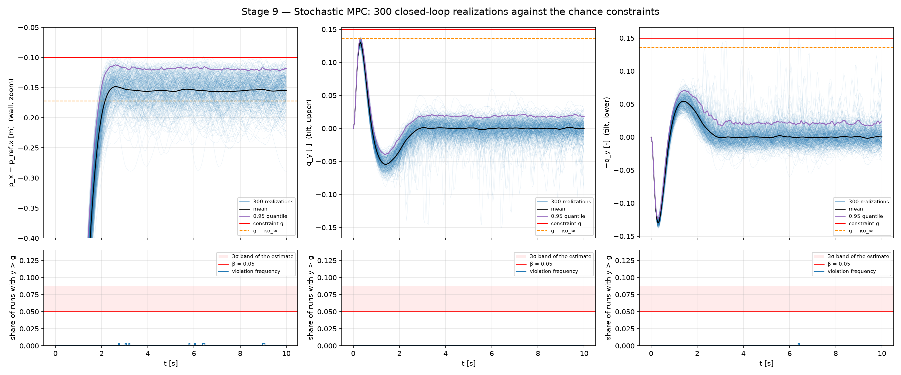
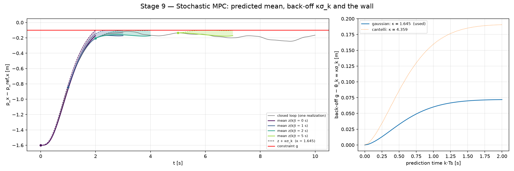
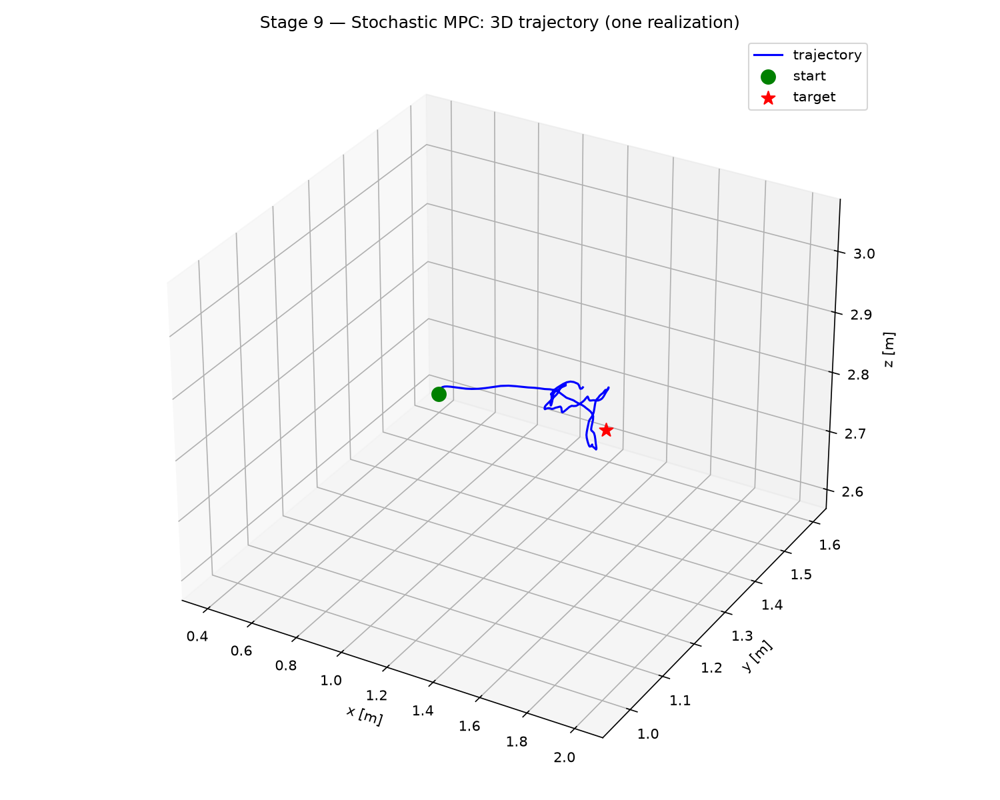
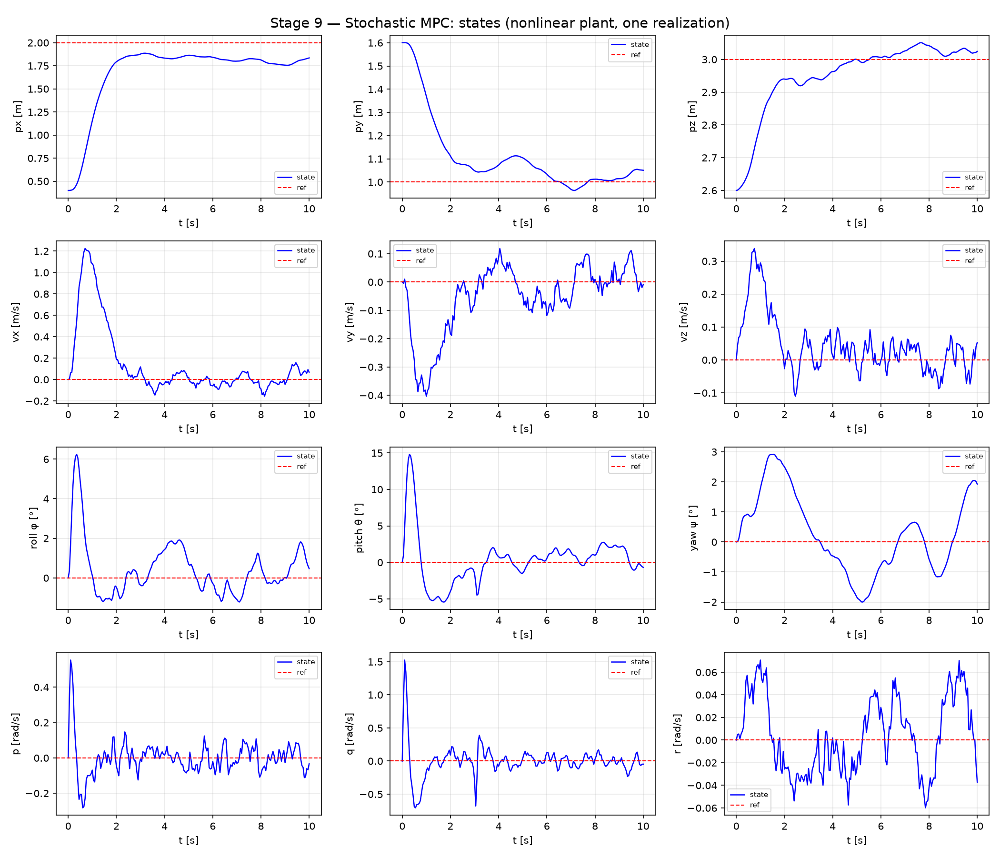
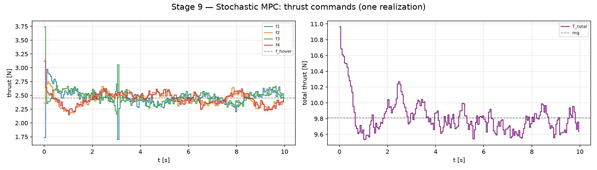

# Stage 9 — Stochastic MPC with Chance Constraints

Stage 8 keeps the constraints for **every** disturbance in a bounded set. If the disturbance is
random, the worst-case sequence is extremely unlikely, and a controller designed for it gives away
performance. This stage implements **linear stochastic MPC with chance constraints** (Kouvaritakis
& Cannon, 2016, ch. 6–7; Farina, Giulioni & Scattolini, 2016): a state constraint may be violated,
but only with a prescribed probability $\beta$. The stochastic problem is rewritten as an ordinary
QP with tightened constraints, and the tightening is computed offline from the error covariance.

As in Stage 8, the controller is linear and the plant is the **nonlinear** quadrotor with
rotor-speed dynamics.

| | |
|---|---|
| Prediction model | hover linearization of the thrust-lag model, 16 states, ZOH at $T_s = 0.05$ s (the one of Stage 8) |
| Plant | `create_rotor_plant(Ts)` — rotor speeds, ESC loop, $f = k_f \Omega^2$, ERK4, $`d(t) \sim \mathcal N(0, \Sigma_d)`$ i.i.d. per sample |
| Feedback | full state (rotor thrusts included) |
| Horizon | $N = 40$, $T = 2$ s |
| Solver | acados `SQP` (one step — the OCP is a QP), `PARTIAL_CONDENSING_HPIPM`, `DISCRETE` dynamics |
| Offline | `compute_smpc_params.py` → `data/smpc_params.npz` |
| Entry point | `./run.sh stage9_smpc/simulate_smpc.py` → `results/stage9_smpc/` |
| Git tag | `stage9` (13-state model; tag `rigid-body` = all stages before the motor dynamics) |

---

## 1. The stochastic problem

```math
x^+ = A x + B u + w, \qquad w \sim \mathcal N(0, \Sigma_w) \ \text{i.i.d.}
```

with state constraints $G x \le g$ and input constraints $H u \le h$. Row $j$ of the state
constraint is asked to hold with probability $1 - \beta_j$, given the measured state:

```math
\Pr\{\, G_j\, x(k|t) \le g_j \mid x(t) \,\} \ge 1 - \beta_j , \qquad k = t+1, \dots, t+N ,
```

and the cost is the expected value of the usual quadratic cost.

## 2. Deterministic equivalent

**Split.** Let $`z(k|t) = \mathbb E\{x(k|t)\}`$ with $z(t|t) = x(t)$, the error $e = x - z$, and the
predicted input $u = v + K e$ with a stabilizing gain $K$. Then

```math
z^+ = A z + B v, \qquad e^+ = (A + BK)\, e + w = A_K e + w, \quad e(t|t) = 0 .
```

The mean carries no randomness, and the error does not depend on $x(t)$ or on the decision $v$.

**Cost.** With $`\mathbb E\{e\} = 0`$ all cross terms vanish:

```math
\mathbb E\Big\{ \sum_k \lVert x \rVert_Q^2 + \lVert u \rVert_R^2 \Big\}
= \sum_k \lVert z \rVert_Q^2 + \lVert v \rVert_R^2 \;+\; \underbrace{\sum_k \operatorname{tr}\big( (Q + K^\top R K)\, \Sigma_e(k) \big)}_{\text{constant}} ,
```

so the OCP minimizes the nominal cost of the mean.

**Covariance.** Because $w$ is i.i.d. and zero mean,

```math
\Sigma_e(k+1) = A_K\, \Sigma_e(k)\, A_K^\top + \Sigma_w , \qquad \Sigma_e(0) = 0 ,
```

a recursion that needs no measurement — it is evaluated once, offline.

**Chance constraint.** $G_j x \le g_j$ is $G_j z \le g_j - G_j e$, and $G_j e(k)$ is a zero-mean
scalar with standard deviation $`\sigma_{j,k} = \sqrt{G_j \Sigma_e(k) G_j^\top}`$. The constraint
on the mean is therefore

```math
G_j\, z(k|t) \le \theta_{j,k} = g_j - \kappa_j\, \sigma_{j,k} ,
\qquad
\kappa_j = \begin{cases} \Phi^{-1}(1 - \beta_j) & \text{Gaussian } w \text{ (exact)} \\[2pt] \sqrt{(1 - \beta_j)/\beta_j} & \text{any distribution (Cantelli)} \end{cases}
```

For $\beta = 0.05$: $\kappa = 1.645$ (Gaussian) against $4.359$ (Cantelli). The run uses the
Gaussian factor (`METHOD`); the distribution-free one is implemented and printed next to it.

**Inputs.** The predicted input $v + K e$ is random as well, so $H u \le h$ is tightened the same
way with $`\sqrt{H_j K \Sigma_e(k) K^\top H_j^\top}`$. At $k = 0$ the error is zero, so
$\eta_{j,0} = h_j$: the applied input $u(t) = v(t|t)$ is deterministic and the command limits are
**hard** in closed loop.

**The OCP** solved at every sample:

```math
\begin{aligned}
\min_{v} \quad & \sum_{k=0}^{N-1} \lVert z_k \rVert_Q^2 + \lVert v_k \rVert_R^2 + \lVert z_N \rVert_P^2
\\ \text{s.t.} \quad & z_{k+1} = A z_k + B v_k, \qquad z_0 = x(t)
\\ & G z_k \le \theta_k \quad (k = 1..N), \qquad H v_k \le \eta_k \quad (k = 0..N-1) .
\end{aligned}
```

$K$ and $P$ are the LQR gain and the DARE solution of $(Q, R)$. $K$ appears in the OCP only
through $\theta_k$ and $\eta_k$.

**Difference to Stage 8.** The tube MPC lets the nominal state run on its own and tightens by a
constant set. Here $z_0 = x(t)$ at every sample, so the predicted error restarts at zero and the
tightening **grows along the horizon**.

## 3. From the quadrotor to $x^+ = Ax + Bu + w$

Coordinates are those of Stage 8: $`x = [p - p_{\text{ref}},\ v,\ q_x\, q_y\, q_z,\ \omega,\ f - f_{\text{hover}}]`$,
$u = f_{\text{cmd}} - f_{\text{hover}}$. The rotor thrusts $f$ lag the commands ($\tau_m = 30$ ms)
and are part of the state, so $K$ feeds them back too; here they are known exactly.

- **Disturbance.** $`d = [d_f;\ d_\tau] \sim \mathcal N(0, \Sigma_d)`$ with $\sigma_f = 0.5$ N
  (≈ 5 % of the weight) and $\sigma_\tau = 5 \cdot 10^{-3}$ N·m, drawn anew at every sample.
- **$\Sigma_w$.** $w = G_d\, d$ with $G_d = \partial F / \partial d$ at hover, the Jacobian of the
  rotor plant's own RK4 step, so $\Sigma_w = G_d \Sigma_d G_d^\top$. Its thrust rows are zero: $d$
  acts on $\dot v$ and $\dot\omega$, not on the rotors. The thrust part of $\Sigma_e(k)$ only builds
  up through the feedback, from $k = 2$ on.
- **What is left out.** The linearization error of Stage 8 is *not* in $\Sigma_w$: neither the
  rigid-body part nor the rotor loop (quadratic in the command lead, [Stage 8 §2](stage8_tube.md#the-rotor-loop-and-the-command-lead)).
  It is neither zero-mean nor independent of $x$. The tilt chance constraint keeps the plant where
  that error is small, and the checks below are done on the nonlinear rotor plant.

Constraints:

| Row | Constraint | $\beta$ |
|---|---|---|
| wall | $`p_x - p_{\text{ref},x} \le -0.10`$ m | 0.05 |
| tilt (4 rows) | $\lvert q_x \rvert, \lvert q_y \rvert \le 0.15$ (≈ 17°) | 0.05 each |
| commands (8 rows) | $F_{\min} \le f_{\text{cmd},i} \le F_{\max}$ (the rotor plant clips to this box) | hard at $k = 0$, 0.05 for $k \ge 1$ |

Offline result (`compute_smpc_params.py`): $\rho(A_K) = 0.960$; the wall back-off grows from 1 mm
at $k = 1$ to 72 mm at $k = N$ (stationary value 72.2 mm), the tilt bound shrinks from 0.150 to
0.136, the command box by at most 0.16 N. On the 13-state model (thrusts as input) the stationary
wall back-off was 67 mm: the thrust lag makes the feedback slightly slower.

**Self-test** (`--check`): 20 000 realizations of the error system through the nonlinear rotor
plant, open loop over the horizon. The sample standard deviations match $`\sqrt{G \Sigma_e G^\top}`$
within 1.6 % (inputs: 0.984–1.012), and the coverage $`\Pr\{G_j e(k) \le \kappa \sigma_{j,k}\}`$ is
0.946–0.954 for the target 0.95. The sample mean stays within 0.04 σ of zero. This is the statement
the tightening rests on, and it holds on the nonlinear plant.

## 4. Feasibility

A Gaussian has unbounded support, so no tightening makes $z_0 = x(t)$ feasible for every
realization. Recursive feasibility needs a bounded support with an extra tightening (Lorenzen et
al., 2017) or an interpolated initial state (Köhler & Zeilinger, 2022); neither is implemented
here. Instead the state rows are **soft** with an exact $L_1$ penalty: the slack is zero whenever
the tightened problem is feasible, and the OCP stays solvable otherwise. The input rows stay hard.

## 5. Mapping to acados

- `DISCRETE` dynamics $z^+ = Az + Bv$, `LINEAR_LS` cost, `cost_scaling = 1` on every node.
- One general-constraint block $`[G\ 0;\ 0\ H]\,[z; v] \le [\theta_k; \eta_k]`$; the right-hand
  side is written per node with `constraints_set(k, 'ug', …)`, `lg = −ACADOS_INFTY`.
- Node 0 carries the state rows too, with $z_0$ fixed — they are switched off by a large bound.
- Slacks on the state rows (`idxsg`, `idxsg_e`), `Z_L1 = 1e4`.

## 6. Scenario

The drone starts at rest, rotors at hover speed, 1.5 m in front of the wall. The target hover
point lies 0.1 m **behind**
the wall, so the cost pushes against the chance constraint for the whole run. A probability cannot
be checked on one run: 300 independent closed loops (seeds 0–299, 10 s each) give the violation
frequency at every sample.

## 7. Results

| Quantity | Value |
|---|---|
| OCP status ≠ 0 | 0 / 60 000 |
| Solves that needed the soft rows | 31 / 60 000 (largest slack 5.4 mm) |
| Wall violation frequency, worst sample | 0.33 % (β = 5 %) |
| Wall violation frequency, mean for $t \ge 4$ s | 0.02 % |
| Tilt violation frequency, worst sample | 0.33 % on $-q_y$ (one run), 0 on the other three rows |
| Thrust commands | 0.074 … 7.357 N, inside $[F_{\min}, F_{\max}] = [0.074, 7.357]$ |
| Commands on the box | 0.01 % of the samples (6 of 60 000, in 5 runs, all at $t \in [3.0, 6.75]$ s) |
| Distance to the wall, $t \ge 4$ s | mean 55 mm, std 25 mm |
| Solver time | mean 6 ms, max 56 ms (one SQP step; wall-clock on WSL, the max is a single outlier) |



Every realization is a thin line; the chance constraint is a statement about the **0.95 quantile**
(purple), which has to stay below the red line. Bottom row: the share of runs outside the
constraint against $\beta$.



Left: four predictions of one run. The upper edge of each band is $z + \kappa \sigma_k$; the OCP
constraint says that this edge stays below the wall, so the mean may be close to the wall at the
start of the horizon and has to retreat towards its end. Right: the back-off over the prediction
time for both factors.

<p align="center">
  
</p>





## 8. Observations and limitations

- **The closed loop is far below $\beta$.** The prediction is exact (self-test: coverage 0.95),
  but it describes the open-loop policy $v + Ke$ over the horizon. In closed loop the MPC
  re-plans from the measured state at every sample, which acts as a stiffer feedback near the
  active constraint: the measured standard deviation at the wall is 25 mm, the predicted
  stationary one 44 mm. The drone hovers 55 mm from the wall, about 2.2 measured standard
  deviations. Using the open-loop covariance for a closed-loop controller is the known source of
  conservatism of this formulation.
- **The price of re-planning near the wall** is visible in the tilt panels: single realizations
  show short tilt spikes in steady state, when a gust pushes towards the wall and the soft
  constraint is close to active. In 5 of 300 runs such a spike drives a command onto the box
  for one sample; the box is hard at $k = 0$, so the command stays inside it.
- **No recursive-feasibility guarantee.** 31 of 60 000 solves needed the slack. With bounded
  support or an interpolated initial state this can be proven ([§4](#4-feasibility)).
- **Gaussian assumption.** The factor $\Phi^{-1}(1-\beta)$ is exact only for Gaussian $w$. For an
  unknown distribution the Cantelli factor gives the guarantee at 2.6× the back-off.
- **Linear model.** $\Sigma_w$ contains the effect of $d$ only. The match in the self-test holds
  for tilt up to ≈ 17° and for the rotor loop at these gusts; a larger envelope would need the
  linearization error in the model.
- **Thrust is fed back.** $K$ uses the rotor thrusts. Without rpm telemetry they come from an
  estimator (Stage 4), and the estimation error adds to $\Sigma_e$.
- **Per-row constraints.** Each row holds with its own probability; the probability that *all*
  rows hold at once (a joint chance constraint) is lower and is not constrained.

## Files

| File | Role |
|---|---|
| `compute_smpc_params.py` | $\Sigma_d$, constraint rows and $\beta$; `disturbance_gain()`, `lqr()`, `error_covariance()`, `backoff_factor()` (Gaussian / Cantelli), `row_std()`; `save/load_smpc_params()`; `self_test()` (`--check`) |
| `ocp_config_smpc.py` | OCP: `create_solver()`, `set_tightening()`, `solve()`, `shifted_plan()`, `warm_start()` |
| `simulate_smpc.py` | entry point: scenario, `run_once()`, Monte Carlo, `violation_frequency()`, `summarize()`, figures → `results/stage9_smpc/` |
| `data/smpc_params.npz` | $A, B, G_d, \Sigma_w, K, P, \Sigma_e(k), \theta_k, \eta_k$, cost |
| `plot_utils.py` | `plot_smpc_chance()`, `plot_smpc_prediction()` |

```bash
./run.sh stage9_smpc/compute_smpc_params.py  # → data/smpc_params.npz
./run.sh stage9_smpc/compute_smpc_params.py --check  # self-test: covariance and coverage on the nonlinear plant
./run.sh stage9_smpc/simulate_smpc.py       # → results/stage9_smpc/ (300 runs, several minutes)
QUAD_PLOTS=none ./run.sh stage9_smpc/simulate_smpc.py  # save only, no windows
```

## References

- B. Kouvaritakis, M. Cannon, *Model Predictive Control: Classical, Robust and Stochastic*,
  Springer, 2016.
- M. Farina, L. Giulioni, R. Scattolini, "Stochastic linear model predictive control with chance
  constraints — a review," *Journal of Process Control* 44, 2016.
- L. Hewing, M. N. Zeilinger, "Stochastic model predictive control for linear systems using
  probabilistic reachable sets," *IEEE Conference on Decision and Control*, 2018.
- M. Lorenzen, F. Dabbene, R. Tempo, F. Allgöwer, "Constraint-tightening and stability in
  stochastic model predictive control," *IEEE Transactions on Automatic Control* 62(7), 2017.
- J. Köhler, M. N. Zeilinger, "Recursively feasible stochastic predictive control using an
  interpolating initial state constraint," *IEEE Control Systems Letters* 6, 2022.
